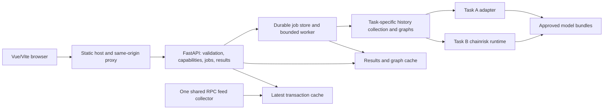

# Frontend and serving design review

Date: 2026-10-12. Status: proposal for discussion, not an adopted contract
revision or an implemented application. This review creates no services and
changes no training code, labels, model weights, or existing contracts.

## Evidence and conclusion

The proposed Home / Token Forecast / ETH Scam / Token Scam navigation is
reasonable for a unified Ethereum analysis platform. Vue 3, TypeScript, Vue
Router and Vite with a Python FastAPI backend fit the existing repository.
Modernization should replace demo routing and interaction logic as well as CSS.

Reviewed conversations include “实现 Scam 检测基础流程”, “梳理 DeFi 风险监测项目背景”
and “分析Canvas方案可行性”. The latest Task B discussion accepts limited initial
Honeypot and Rug Pull implementations: API-defined sell-restriction screening
and retrospective identification of documented v2 malicious withdrawals.
It does not establish that the additional code or trained bundles exist.

Repository evidence: [project contract](../../CONTRACT.md),
[Task B release guide](../../docs/TASK_B_IMPLEMENTATION.md),
[task registry](../../packages/chainrisk/tasks.py),
[graph strategies](../../packages/chainrisk/graph.py),
[offline prediction](../../research/task_b/cli.py),
[platform guide](../../docs/PLATFORM_ENGINEERING_AND_DATA_GUIDE.md), and
[earlier serving plan](../../docs/TASK_B_CODEBASE_AND_SERVING_PLAN.md).

This is the earlier exploratory review. The website architecture revision on
2026-10-12 is now recorded in [WEBSITE_ARCHITECTURE.md](WEBSITE_ARCHITECTURE.md)
and the project contract: Vue/Vite plus FastAPI supersedes the unimplemented
Nuxt/Nitro plan. The ETH Scam and Token Scam content specifications govern their
selected panels; this review's broader panel/Task A examples are background.

## Current readiness

| Area | Implemented | Remaining for serving |
|---|---|---|
| Frontend | Vue/Vite reference under `apps/frontend` | Real jobs, API integration, reusable results, modern layouts |
| Task A | Research pipelines and historical experiment reports | Checkpoint/input compatibility adapter, approved model bundle, online data adapter |
| Phishing/Ponzi | Collection, graphs, train/evaluate/export/predict code | Admitted real data, formal training/evaluation, approved weights and HTTP service |
| Honeypot/Rug Pull | Evidence import, token/pool collection and initial graphs | Label adapters/admission, token-specific coverage recipe, training/bundle support |
| Deployment | Responsibility placeholders | FastAPI entrypoints, worker, registry operation and transaction feed |

The current registry marks Honeypot/Rug Pull `data_only`. Phishing/Ponzi are
code-trainable, not already trained. The old live-data page uses a timer and
redirect; it is not an RPC implementation.

## Navigation and entity mapping

| Route | Purpose | Targets and task semantics |
|---|---|---|
| `/` | Platform overview and recent Ethereum activity | Chain facts and analysis entrypoints |
| `/token-forecast` | Task A early activity forecast | Token in selected pools; first seven days predict subsequent 90-day low-volume outcome |
| `/eth-scam` | Ethereum address/contract screening | Phishing for addresses; Ponzi for eligible contracts |
| `/token-scam` | ERC-20 analysis workspace | Token Honeypot/v2 Rug Pull, plus explicitly targeted Ponzi/Phishing analyses |
| `/analyses/:id` | Persistent job/result detail | Internal route; no extra top-level navigation required |

Keep “ETH Scam” if desired, but use the subtitle “Ethereum Address & Contract
Screening”. Restricting it to contracts would omit phishing address targets.

An ERC-20 address is a contract address, so direct contract/address checks may be
possible if their admitted model scope and history fit. Their outputs still
refer to that exact address/contract. A token dashboard can also assess a
verified associated business contract or address separately. Association never
transfers labels to the token, its deployer, pool, holders, or entire project.
Unresolved associated entities are shown as unresolved rather than inferred.

Use the existing `address_flow` recipe for Phishing/Ponzi and `token_v2` for
Honeypot/Rug Pull. A single page may orchestrate both recipes; it cannot send
one token graph indiscriminately to all four task models. They remain independent,
potentially overlapping binary tasks with separate weights and thresholds.

## Page layout and interaction

Use a consistent shell: restrained neutral background, one primary accent,
clear spacing, tabular numeric typography, readable abbreviated addresses with
copy/full-address actions, and status colors supplemented by text/icons.
Desktop uses two-column results; mobile stacks the same information. Charts and
graphs follow the primary result rather than occupying the whole first screen.

Home: compact platform introduction and unified address search; three task
entry cards; current block/source freshness; recent transaction table. The
live panel is subordinate to the analysis workflow. Do not show invented
platform accuracy or “safe transaction” counts.

Token Forecast: token address and eligible pool scope, observation timeline,
first-week activity summary, low-volume model result and supporting graph.
Display the actual observation and outcome dates. The existing task does not
forecast price or the next 90 days from an arbitrary current date. A token under
seven days old cannot use a complete seven-day input yet; an older-token replay
must be labeled historical. USD evidence must satisfy the existing Task A input
contract, not be replaced by live ETH value or current-price conversions.

ETH Scam: address input, optional historical assessment time, resolved target
type/role and independent Phishing/Ponzi cards. Ponzi is unavailable for
ineligible entities. Show address-flow graph, activity summaries, coverage,
source evidence and model versions. Do not equate a score below threshold with
a guarantee of safety.

Token Scam: token metadata, verified pool selection, assessment cutoff and four
independent result cards. Honeypot is sell-restriction screening under its
defined label. Initial Rug Pull covers documented malicious Ethereum Uniswap
v2 withdrawals at/after an incident, not general early warning or v3 coverage.
Ponzi/Phishing cards prominently identify their actual assessed entity.

Every result view includes task, assessed entity, cutoff/window, score meaning,
threshold decision, data quality/freshness, model version and evidence origin.
Use “model score” for uncalibrated outputs; avoid displaying it as fraud
probability. Model output, external API evidence and demo fixtures remain
visibly distinguishable. Graphs show node roles and relation legends; disclose
cropping relative to the model input. Observed patterns are not automatically
causal model explanations.

Proposed job phases: queued -> resolving -> collecting -> building graph ->
predicting -> completed/partial/failed. These are service/UI additions, not
existing runtime statuses. Show actual stages and measured counts, not fabricated
percentages or fixed five-second transitions. Per-task statuses retain existing
`data_only` and `model_unavailable`; additional reasons can include unsupported
entity/pool, insufficient history and collection failure. Null scores display
as unavailable with a reason, never zero or green normal. One failed task must
not hide another completed result.

## Service and deployment design

One modular FastAPI application plus a separate worker is enough initially.
Keep Token/Scam modules independently callable; separate model-service processes
only when memory, dependencies, scaling or fault isolation justify them.
Use async clients for network I/O. Existing synchronous collection must run
off the API event loop or be adapted; PyTorch work needs bounded execution.
Load admitted models once per inference process, use frozen preprocessing and
inference mode, and account for each process's model memory. Web requests do not
invoke training entrypoints or fit scalers/thresholds.

Build Vite assets for static hosting with SPA deep-link fallback. Proxy `/api`
to FastAPI and support streaming without proxy buffering when using SSE.
API/provider credentials live on the server. Keep live-feed collection single
owned so multiple API processes do not duplicate RPC subscriptions.

Proposed API surface:

- `GET /api/capabilities`: supported entities/pools/tasks and admitted models.
- `POST /api/analyses`: explicit target, tasks and optional cutoff; resolve and
  freeze cutoff/block identity; return an analysis ID, normally HTTP 202.
- `GET /api/analyses/{id}`: persisted job state and per-task results.
- `GET /api/analyses/{id}/graph`: bounded display graph and provenance.
- `GET /api/network/summary` and `/api/transactions/recent`: initial snapshots.
- `GET /api/stream`: optional server-to-browser updates with reconnect support.

Persist jobs/results so refresh or process restart does not discard the analysis.
Cache by chain, target, task, cutoff/block identity, graph/feature/model and
evidence versions. A “latest” request resolves to a specific snapshot before
cache lookup. Add request deduplication, bounded concurrent collection, timeouts
and retry policy. A durable job table and small worker can precede a larger
queue system; the design does not require Kubernetes or many microservices.

## RPC transaction dashboard

Start with recent transactions included in blocks. Subscribe to `newHeads` over
a supported provider WebSocket and fetch full blocks, or poll block height over
HTTP. Record block hash/parent hash and a cursor; recover missed block ranges
after reconnect and handle reorganization replacement. Notifications alone are
not a historical backfill mechanism.

Cache centrally and fan out to browsers using SSE; short polling is a simpler
first release alternative. Keep approximately 20-50 visible rows with bounded
history, pause/resume, “new transactions” indicator, filters and stable reading
position. Do not continuously force-scroll while the user is inspecting a row.

Initial fields: transaction hash, block number, block timestamp, from/to, native
ETH value, inclusion/finality state, and an analysis action. A missing `to` means
contract creation. ETH `value` is not token transfer value. Receipt success,
actual gas usage and decoded token transfers require receipt/log retrieval;
fetch these for visible rows or detail views within a defined budget. Label
simple calldata-derived summaries as such; reliable method names need ABI
resolution. Newly included transactions are not necessarily finalized.

The feed provides chain activity. A selected transaction can resolve entities
and initiate their analyses; the existing resolver returns roles, not a
transaction-level scam score. Do not run full multi-hop inference on every feed
row. Standard block/log RPC also does not replace the indexed address histories,
internal-transfer coverage and historical USD inputs required by the tasks.

## Implementation sequence and acceptance

1. Freeze proposed result/capability schemas and page wireframes. After adoption,
   revise Nuxt-specific contract/design references to Vue/Vite + FastAPI.
2. Modernize the shared shell and four pages; use explicit fixtures and all
   empty/unavailable/partial states. Upgrade dependencies as a coordinated,
   verified change rather than preserving old versions by default.
3. Implement FastAPI jobs/results and one real-data Phishing or Ponzi service
   path with an admitted bundle; verify one successful and one unavailable case.
4. Connect the independent RPC feed and verify reconnect/backfill, reorganization,
   pause/resume and stale-source states.
5. Verify Task A checkpoint compatibility and its seven-day input service.
6. Add the accepted finite Honeypot/v2 Rug Pull training and service paths;
   enable each card from capabilities only after the relevant bundle is admitted.

Frontend work can proceed independently of model readiness. End-to-end acceptance
includes refreshed/deep-linked results, partial task completion, accurate null
states, task/entity/window attribution, compatible inputs, bounded collection
and model resources, mobile layout and explicit fixture provenance.
Research model quality remains a separate acceptance decision.

## Primary technical references

- [Vue tooling](https://vuejs.org/guide/scaling-up/tooling.html): Vue/Vite support.
- [FastAPI concurrency](https://fastapi.tiangolo.com/async/): network concurrency
  versus computation parallelism.
- [FastAPI background tasks](https://fastapi.tiangolo.com/tutorial/background-tasks/):
  heavier work and external worker/queue considerations.
- [Ethereum JSON-RPC](https://ethereum.org/developers/docs/apis/json-rpc/): block,
  transaction, receipt, logs and finality tags.
- [Geth subscriptions](https://geth.ethereum.org/docs/interacting-with-geth/rpc/pubsub):
  new heads, connection lifetime, missed notifications and chain reorganizations.
