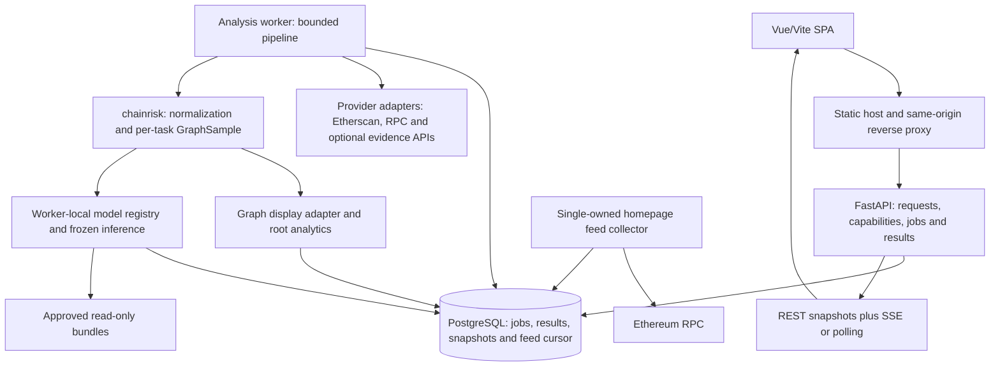

# Website architecture: Vue/Vite and FastAPI

Serving revision (2026-10-25): the model server owns score-to-label policies;
the backend validates and forwards returned labels. Input-only configuration now
ships in `apps/backend/config/`; backend runtime does not include or import
`deploy/`. Eligible live-mock inputs return 0.999 / High Risk for Scam or
0.999 / Continued activity for Forecast, with explicit simulated provenance.
This supersedes earlier random-score and backend-policy descriptions below.
See [MODEL_SERVICE_CONTRACT.md](MODEL_SERVICE_CONTRACT.md).

Forecast live scope (2026-10-24): the shared worker now also collects real
creation-based first-seven-day token/pool events, publishes facts/ledger/activity
progressively and delays its bounded wallet/pool/token graph until collection
settles. It uses the native Task A wallet builder and a user-authorized mock
predictor with an independent replaceable 0.5 decision file. Historical USD
stays missing; the eventual trained Forecast bundle/scaler remains pending.
See [Forecast live adapter](FORECAST_LIVE_ADAPTER.md).

ERC-20 live scope (2026-10-24): `token_scam` now uses the same durable queue,
shared Etherscan budget, progressive complete 30-day facts/ledger/activity and
delayed bounded display graph as ETH. Canonical Uniswap v2 token/pool verification
and independent directed edge-aware Honeypot/Rug Pull input recipes remain
task-specific. Unsupported inputs display Unavailable with a null score and
small reason text. See [ERC-20 live adapter](TOKEN_LIVE_ADAPTER.md).

The user-confirmed [2026-10-24 live backend revision](LIVE_BACKEND_IMPLEMENTATION.md)
supersedes display/model graph equality and earlier online quota assumptions
below. It separates recent display data (64 total nodes, up to 30 days) from frozen model samples,
sets Etherscan 3/sec and 99,000/UTC-day, and defines actual progress, explicit
failures and durable quota pauses. The [ETH live adapter](ETH_LIVE_ADAPTER.md)
now implements real collection and a local durable worker, with temporary random
scoring as explicitly requested. Frontend text and the original task selector
remain; address statistics/ledger progressively cover the full 30 days; the bounded
graph is published once those records settle. Model
samples stay on the backend. Trained model serving remains pending.

Design revision: 2026-10-12. Status: target website blueprint with initial empty
frontend and runnable API/class templates delivered in
[TEMPLATE_DEVELOPMENT.md](TEMPLATE_DEVELOPMENT.md); real integrations and deployed
analysis services remain unimplemented. The user's Vue/Vite preference,
selected ETH/Token Scam contents and homepage feed determine this design.
Replace the earlier unimplemented Nuxt/Nitro application plan; preserve all
research labels, graph recipes, training entrypoints and historical artifacts.
This is a website architecture contract revision, not a model-contract revision.
Forecast now uses the canonical frozen fixture/job workflow; real model and API
integration remains deferred (2026-10-13).

## 1. Existing frontend and reconstruction boundary

The former `apps/frontend` was a reference demo; its source and static assets
have now been removed and replaced with the empty development template. Input views compare fixed
addresses/hashes and redirect to fixed result routes after a timer. Result
views hardcode graph nodes/coordinates, risk text and account/transaction values.
Explorer alternates two static arrays. Reviewed source contains no real
fetch/axios, RPC subscription or inference integration.

Rebuild views, routes, application state, API integration, charts and graph
adapters while retaining Vue 3, TypeScript, Vite and Vue Router. Reuse suitable
assets/components after review and preserve source attribution. Dependency
upgrade and frontend code reconstruction are subsequent implementation tasks.
No existing training or model compatibility is established by this demo.

## 2. Logical and physical architecture

Use a modular Python application, not one service per scam type. Share installed
`chainrisk` runtime mechanics and keep per-task models/recipes independent.
Start with separate API, analysis-worker and homepage-feed processes so long
collection or inference cannot stall browser requests or the feed.



PostgreSQL is the first deployment's durable job/result store. A leased job table
can serve as the initial queue; a separate broker/Redis is optional when scale
justifies it. Store larger raw events and graphs in a separate service-owned
artifact volume/object store, with immutable references/checksums in the DB.
SQLite can substitute for single-worker local prototyping; it is not the default
for a multi-process production deployment.

API processes do not load model weights. The analysis worker loads approved
bundles once per process and owns bounded inference. Later, if model memory,
GPU scheduling or independent scaling requires it, replace the in-process
predictor adapter with an internal inference HTTP service. Do not create that
extra service merely because four tasks exist.

## 3. Responsibility boundaries and design patterns

| Pattern / boundary | Concrete use | Reason |
|---|---|---|
| Layered design with ports/adapters | HTTP routes -> application services -> runtime interfaces; providers/stores/models injected at composition roots | Keep framework/provider/storage details out of task semantics. |
| Application facade / orchestration | AnalysisService accepts work and reads results; AnalysisPipeline executes normalized stages in the worker | Pages need one analysis operation, not separate browser-managed collection/build/predict chains. |
| Strategy plus registry | Task handlers choose address_flow or token_v2 recipes, eligibility, sources and independent bundles | Reuse pipeline mechanics without making all tasks one graph or one model. Existing TaskSpec/graph registries are the starting point. |
| Provider adapters | Etherscan history, RPC state/feed, optional Honeypot evidence | Normalize provider responses, errors, pagination and provenance centrally. |
| Read/write separation | POST creates analysis commands; GET reads immutable results and progress | Refresh/reconnect must not restart scraping or inference. No separate CQRS framework is required. |
| Explicit state machine | Persist job stages, task statuses and phase events | Real loading/progress, retries and partial results replace timer redirects. |
| Repository abstraction | Job/result/event/graph/bundle-index ports | Isolate storage and caching choices from routes and task handlers. |
| Snapshot/value objects | Immutable assessment context and GraphSample reference | Bind model and graph display to the same entity/window/recipe/version. |
| Managed process lifecycle | Worker-local registry; single-owned feed collector with persisted cursor/lease | Avoid per-request model loading and one RPC scan per browser. A Python singleton does not coordinate multiple processes. |
| UI composition / presenters | Common workbench shell and task-specific view adapters | Reuse panel structure while preserving wallet versus token meanings. |
| Theme and icon adapters | Semantic design tokens, AppIcon and chart theme adapter | Future style/icon replacement does not alter API/domain logic. |

These are extension boundaries, not a requirement to create an abstract class
for every helper or adopt a generic pipeline framework. Prefer explicit typed
protocols and small composition functions.

## 4. Analysis lifecycle and graph/score consistency

1. Browser submits address, page/task family, optional pool scope and cutoff.
2. API validates request shape, assigns analysis_id and persists the job;
   normally respond HTTP 202. Resolve cheap metadata in API or in the worker's
   resolving stage; always freeze context before historical collection.
3. Worker claims a leased job and resolves entity type, token/pool mapping and
   task/model eligibility. An eligible EOA has Ponzi Not applicable; a contract
   does not automatically disable Phishing. Each admitted bundle's scope applies.
4. Freeze assessment context: chain, entity, cutoff block/hash/time, source scope,
   per-task graph/feature recipes, chosen bundle and band-policy versions.
5. Fetch cutoff-bounded facts through provider adapters; save raw provenance,
   coverage and normalized events. Current balance/metadata, if shown, retain
   a separate state/retrieval time and do not become historical model features.
6. Build each task's GraphSample using installed chainrisk functions. Keep a
   stable sample ID/content reference; no training label is needed for prediction.
7. Derive graph display DTO from that SAME sample and lineage, and root analytics
   from declared collected histories. Sampling is not a complete-account total.
8. Validate bundle/schema/quality; perform frozen inference and thresholding.
   Optionally assign three bands under an admitted versioned display policy.
9. Persist per-task results and display artifacts. Serve graph/facts even when
   useful data exists but a model is unavailable. One task failure does not
   erase successful results from another.

Stages: queued -> resolving -> collecting -> normalizing -> building_graph ->
predicting -> completed/partial/failed. Optional enrichment has its own status.
Expected Not applicable is not a task error. Partial means usable facts/results
exist but required outputs are unavailable; failed means no usable requested
analysis output. Persist finer per-task statuses rather than inferring them from
one job flag. Current runtime codes such as data_only/model_unavailable are
mapped explicitly; these orchestration stages are new service requirements.

Frontend rendering and model inference can finish at different times. Consistency
depends on sample_id/snapshot identity, not which response arrives first. Each
task result carries its graph reference; switching tasks displays that graph.
Frontend never sends graph coordinates back for prediction or submits a cropped
display graph as the model input. Training/fitting never runs during user queries.

## 5. API contract

Use same-origin `/api/v1`. Typed request/response schemas are defined by FastAPI;
derive TypeScript API types/client from versioned OpenAPI during implementation.
Keep explicit missing/error states in DTOs and validate provider responses.

| Endpoint | Purpose |
|---|---|
| GET /capabilities | Task/entity/pool support and admitted model/band-policy availability; demo versus inference mode. |
| POST /analyses | Create an address/token analysis; body includes target, tasks, optional cutoff/pools; return ID and accepted state. |
| GET /analyses/{id} | Job state, entity/account/token summary and independent task outcomes. |
| GET /analyses/{id}/graphs/{task} | Readable display graph tied to actual inference sample, with sampling/model/display counts and versions. |
| GET /analyses/{id}/activity | Declared-scope daily counts/amounts for selected page; display range only. |
| GET /analyses/{id}/transactions | Paginated external/internal or token/pool event ledger, with deterministic cursor/sort. |
| GET /analyses/{id}/events | Optional SSE progress updates; GET result polling is an initial fallback. |
| GET /feed/recent | Latest sampled included-transaction snapshot and collector freshness. |
| GET /feed/events | SSE homepage feed; shared backend stream, no browser-to-provider connection. |
| GET /health/live and /health/ready | Process liveness and required DB/worker/bundle capability status; do not mark all models available when only API is up. |

Core DTO identities: analysis_id, snapshot_id, task_id, sample_id/graph_ref,
cutoff and block identity, graph/feature/model/policy versions, task status/reason,
score/meaning, threshold decision, calibration, data quality and result origin.
Readable graph nodes/edges join lineage for exact raw amounts; log tensor values
are not displayed as raw ETH. Large tensors, filesystem model paths and weights
do not belong in public DTOs.

POST uses an idempotency key plus request-body consistency checks to avoid duplicate
jobs on resubmission. Reusable artifact keys include chain/entity/task, verified
pool scope, resolved cutoff/block hash, graph/feature/model/evidence versions.
Resolve latest before semantic cache lookup. Reuse unchanged source reads across
tasks when scope permits; do not merge task tensors/results merely to save work.

## 6. Homepage feed lifecycle

Implemented locally on 2026-10-13 with a separate worker and shared SQLite/WAL
store protected by an OS ownership lock. This is a local persistence refinement;
PostgreSQL/shared leases remain required for multi-host deployment. See
[feed integration](FEED_INTEGRATION.md) for configuration and exact retention limits.

One backend owner watches new blocks over supported WebSocket newHeads or HTTP
height polling. Fetch each observed block once with full transaction objects;
persist cursor, hash/parent continuity and source state. Recover missed ranges
and replace affected entries after reorganization within the supported recent
window. Bound catch-up work and distinguish a degraded/gapped feed explicitly.

Maintain a bounded fresh sample instead of queueing every Ethereum transaction
for slow one-per-second playback. Publish at most two NEW positive-native-ETH sampled transactions
per second to a shared sequence, and fan it out to clients. No new transaction
means no invented row. Serve the latest 20-30 rows initially; browser pause/reading
position must not cause historical backlog on resume.

Base fields: hash, from, to, block/time, native ETH value and Gas Limit. Gas Used,
execution status and execution fee require sampled receipt enrichment; missing
fields stay null/pending. Block time is not broadcast time. ETH value is not
ERC20 transfer quantity. Failed transactions' values are attempted values, not
successful payments. New inclusion is not finality. Feed has no scam verdict.

SSE events have stable sequence/event IDs and source freshness. Replay within
retention on reconnect; if expired, send a fresh snapshot/reset rather than
claiming uninterrupted history. The feed collector operates independently of
on-demand graph collection and never triggers all-task inference for each row.

## 7. Frontend, style and icon replacement

Pages: Home, ETH Scam, Token Scam and Forecast activity workbench. The saved-analysis
page and `/analyses/:id` browser route were removed at the user's request on
2026-10-13. Analysis IDs still identify current jobs and their read endpoints. The
2026-10-12 user-confirmed navigation amendment uses Forecast / ETH / ERC-20:
the Chainrisk brand links to Home (`/`), ETH keeps `/eth-scam`, and ERC-20 keeps
`/token-scam`. Forecast links to `/forecast` and, since 2026-10-13, uses the shared
analysis flow with the `forecast` family and `continued_activity` task. Its frozen
backend fixture observes the first seven days and forecasts selected-pool swap
volume over the following 90 days at the USD 1,000 boundary. Research models and
external analysis APIs remain unavailable; see ANALYSIS_ADAPTER_INTEGRATION.md.
Home retains the shared backend ETH RPC transaction-summary dashboard; complete
scam workbenches remain on their own pages. The proposed visual treatment is in
[the visual direction brief](VISUAL_DIRECTION_BRIEF.md), subject to confirmation;
the page-content specifications remain authoritative.
Keep page/workbench composition separate from data
fetching. Composables such as useAnalysis/useFeed own lifecycle, refresh and
subscriptions; dispose connections on unmount. Page view adapters translate
domain DTOs into panel inputs without redefining thresholds or task eligibility.

| Layer | Responsibility | Later replacement |
|---|---|---|
| Pages / workbench | Compose selected panels and page-specific content | Layout can evolve without backend changes. |
| Presenters / view adapters | Wallet/token field labels, units, dates and empty states | Stable domain identities, different presentation. |
| App UI components | AppButton, AppInput, AppPanel, AppTable, StatusBadge, AppIcon | Replace implementations/styles while preserving props/events/slots. |
| Semantic theme tokens | Surfaces, text, borders, accent, risk-low/medium/high, unknown, spacing, typography, radii, density and motion | Central theme changes; risk meaning remains independent of exact color. |
| Icon adapter | Semantic icon names mapped to current library/assets | Swap Lucide, another library or owned SVG in one place. |
| Chart / graph adapters | Renderer configuration, role shapes, theme colors, unit formatting and interaction events | Replace ECharts/Cytoscape or restyle them without page-specific data duplication. |

Business pages reference `AppIcon name="search"`, not a particular library's
component. Maintain one typed IconName mapping and defined size/tone/accessibility
behavior. Preserve existing Lucide only as the initial provider. Search/wallet/
token/copy/external-link/graph/refresh meanings remain stable. Brand logo is a
separate replaceable asset; chart SVG marks are not generic UI icons.

Components consume semantic CSS custom properties and documented variants,
rather than hardcoded page-local colors or third-party class names. Keep layout
structure versus theme appearance separate. UI state has text as well as icons/
color; `unknown` does not reuse `risk-low` or successful-execution appearance.
Avoid tying task IDs or risk-band semantics to palette names.

Canvas/chart libraries need resolved theme colors, not raw CSS variables they
cannot interpret. A ThemeAdapter reads computed tokens and updates chart/graph
options on theme changes. Theme/icon changes must not initiate new analyses or
alter persisted results. Native CSS versus a utility framework can be chosen
at implementation; isolate vendor styling inside app UI components.

Pinia may hold UI preferences, active selections and feed pause state. Server
analysis results remain versioned query state keyed by analysis_id; do not use
a global mutable graph/score that one page can overwrite for another. Unsubscribe
old requests/streams and reject stale-result binding after navigation.

## 8. Proposed directory responsibilities

The following layers now exist as templates. Persistence, external collection,
model serving and graph/chart rendering still need implementation.

```text
apps/frontend/src/
  pages/                       Home, ETHScam, TokenScam, AnalysisDetail
  components/ui/               AppPanel, AppButton, AppIcon, table primitives
  components/analysis/         RiskScreening, BasicInfo, Graph, Activity, Ledger
  composables/                 useAnalysis, useFeed, useTheme
  api/                         generated types/client, transport/error handling
  presenters/                  address/token/graph/feed view adapters
  design/                      semantic tokens, themes, icon registry
  stores/                      UI preferences and selections
apps/backend/app/
  main.py                      FastAPI composition root, not model definitions
  api/                         routers and request/response schemas
  application/                 AnalysisService, pipeline and task handlers
  ports/                       provider, store, predictor interfaces
  adapters/                    provider clients, DB/artifacts, chainrisk predictor
  workers/                     analysis entrypoint and feed entrypoint
packages/chainrisk/             existing shared data/graph/model/bundle code
research/task_b/                preserved offline import/train/evaluate/export
deploy/                        containers, compose, proxy and operations
  registry/                    approved bundle index/read-only mounts
  worker/                      worker deployment configuration
  inference_service/           optional later isolated predictor deployment
```

Initial API/worker can use the existing root frozen Python environment with a
future serving dependency group; install chainrisk as a package and explicitly
load the backend app source path. Root packaging currently excludes apps/deploy,
so do not assume adding a directory automatically makes a runnable installed
service. Production packaging, dependency lock updates and startup commands are
implementation work. Shared models stay in chainrisk, not copied into apps/backend.

## 9. Deployment, recoverability and implementation order

Serve Vite build output through static hosting/reverse proxy; production does
not run Vite's development/preview server. Configure SPA deep-link fallback and
same-origin API routing. SSE proxying needs streaming/timeouts consistent with
heartbeats. A small Compose deployment can run proxy/static, API, analysis worker,
feed worker and PostgreSQL, with service-owned raw/result storage and read-only
approved bundles. Redis or isolated inference is optional later work.

Provider credentials stay in server settings, never VITE public variables. Pin
allowed chains/tasks/pools/provider endpoints server-side; validate request
addresses and budgets. Bound collection/inference concurrency, enforce provider
rate budgets, timeout/retry only recoverable errors and record failures. Job
claims use leases/heartbeats and deterministic artifacts so a restarted worker
can resume/reclaim safely. Do not hold HTTP requests open for full history jobs.
Persist final manifests atomically before announcing completion; readers consume
one consistent version. Unavailable/failed states never silently use demo fixtures.

Implement in order:

1. Freeze DTOs, job/status semantics, UI component/theme/icon contracts and explicit
   fixtures; reconstruct frontend routes/panels without claiming live scores.
2. Implement FastAPI plus durable job/results; connect existing address collection,
   normalization, graph and approved Phishing/Ponzi inference when bundles exist.
3. Verify exact graph/sample binding, partial results, refreshed URLs, provider
   failures, worker restart and compatible model inputs.
4. Implement the independently owned sampled homepage RPC feed and reconnect/
   reorganization/staleness behavior.
5. Complete the accepted limited token graph/coverage/label/training work and
   enable Honeypot/Rug Pull capabilities after bundle admission.
6. Integrate Task A only after its independent checkpoint adapter is verified.

Verification includes pipeline integration and meaningful failure/recovery cases,
contract API types, same-origin deep links, graph-versus-score provenance, chart
units, feed deduplication and theme/icon swaps. Replacing a theme/icon provider
should require no provider/model changes and leave all result values unchanged.
This design does not establish research model quality or real-data serving readiness.

## 10. Sources and related specifications

- [Project contract](../../CONTRACT.md)
- [ETH Scam selected content](ETH_SCAM_WORKBENCH_DESIGN.md)
- [Token Scam selected content](TOKEN_SCAM_LAYOUT_SPEC.md)
- [Task B implementation](../../docs/TASK_B_IMPLEMENTATION.md)
- [Shared task registry](../../packages/chainrisk/tasks.py)
- [Graph runtime](../../packages/chainrisk/graph.py)
- [Model/bundle runtime](../../packages/chainrisk/bundle.py)
- [FastAPI concurrency](https://fastapi.tiangolo.com/async/)
- [FastAPI background tasks](https://fastapi.tiangolo.com/tutorial/background-tasks/)
- [FastAPI lifecycle](https://fastapi.tiangolo.com/advanced/events/)
- [Vite production deployment](https://vite.dev/guide/static-deploy.html)
- [Vue state management](https://vuejs.org/guide/scaling-up/state-management.html)
- [Ethereum JSON-RPC](https://ethereum.org/developers/docs/apis/json-rpc/)
- [Geth subscriptions](https://geth.ethereum.org/docs/interacting-with-geth/rpc/pubsub)
