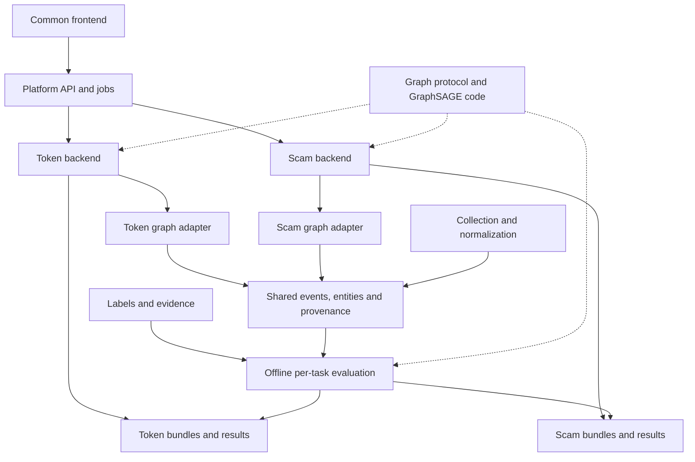

# Risk platform engineering and self-collected data guide

Design date: 2026-10-05; version: platform-engineering-0.1. English/status update:
2026-10-09. This guide refines the [system architecture](SYSTEM_REQUIREMENTS_AND_ARCHITECTURE.md):
one frontend, independent Token/Scam backends, shared graph/GraphSAGE protocols,
separate research results and auditable collection/labeling. Service interfaces
and directory examples are designs, not evidence of running services.

The [codebase plan](TASK_B_CODEBASE_AND_SERVING_PLAN.md) refines graph views,
training/evaluation, `apps/`/`deploy/`, the shared Python package and future Task A
compatibility. Task B offline code now exists; see the
[release guide](TASK_B_IMPLEMENTATION.md). No real collection, formal training
or online service is delivered by this release.

## 1. Positioning and the original Canvas

The engineering objective is an Ethereum platform for token activity and
on-chain scam analysis. Independent business backends reuse data/ML foundations
through a common frontend, with separate analyses, baselines and performance.

| Perspective | Existing scope | Addition/integration |
|---|---|---|
| Original Canvas | Scam detection: transaction graphs, feature/graph models, GraphSAGE, evaluation, optional pretraining | Token activity as another downstream task in a unified platform |
| Repository | Implemented token data engineering and GraphSAGE experiments | Scam adapters and offline train/predict code, followed by future frontend/services |

Canvas covers much of the scam method roadmap, but source admission, labels and
backend engineering remain necessary. Link-prediction pretraining is optional;
Honeypot sell restriction requires independent evidence beyond a graph. A/B
numbering follows the repository, not proposal order. Task A retains seven-day
inputs, subsequent 90-day outcomes, USD 1,000 threshold and primary split.

## 2. Independent backends, shared foundations

Backends should be independently callable, tested, versioned and deployable.
Initial modules/workers may share a repository/process; separate processes or
containers follow actual dependency/resource/scaling needs. The gateway routes
requests and aggregates jobs/results.



| Component | Responsibility | Boundary |
|---|---|---|
| API | Validation, task routing, ids, cache, status and result index | Does not redefine labels or combine incompatible probabilities |
| Token backend | Eligibility, seven-day window, token graph/model and activity result | Low activity is not fraud |
| Scam backend | Phishing/Ponzi/Honeypot/v2 Rug tasks and evidence | Interaction does not transfer malicious labels |
| Shared data | Identity, lineage, time queries and quality | No universal window or label |
| Shared ML | Tensors, batching, SAGE, training, checkpoints, metrics, prediction | No mandatory shared scaler/weights/dimensions |
| Offline jobs | Frozen snapshots, supervision, splits and bundles | No fitting during user queries |

Partial failures preserve successful task results. Shared error codes/envelopes
coexist with task payloads, model versions and health. Pin common dependencies
so upgrades cannot silently alter old inputs. Proposed `POST /analyses` accepts
chain/address/tasks/as_of; async ids are read through `GET /analyses/{id}`.
Cache/idempotency keys include task/entity/cutoff and graph/feature/model/evidence
versions; address alone is insufficient.

## 3. Shared graph structure

Share containers, fields, serialization, validation and batching—not necessarily
topology or one global graph. One event store can derive different task views.

| Layer | Shared | Task-specific |
|---|---|---|
| Identity | `(chain_id, address)`, event ids | Coexisting token/pool/participant/contract roles |
| Container | Nodes/edges/root/cutoff/schema/quality/lineage | Types, relations, windows, hops, sampling |
| Tensors | `x`, `edge_index`, optional attributes/masks/root | Features, units, dimensions, scaler, type dictionary |
| Model | Encode/readout/head interface | Outputs, weights, calibration, threshold |
| Display | Graph renderer | Legends, relations, evidence, access scope |

Task A uses wallet/pool/token topology; address scam graphs use transfers/calls.
Membership is not funds flow; ERC20 Transfer is not Swap. Stored attributes do
not establish that MeanSAGE consumes them. Logical protocol:

```text
GraphSample
  sample_id, task_id, chain_id, target_entity_id, root_node_index
  feature_start, feature_cutoff, data_snapshot_id
  graph_schema_version, graph_view_version, feature_schema_version
  nodes: local_id, entity_id, roles, attributes, missing_mask
  edges: endpoints, relation, direction, attributes, lineage_ref
  quality: scope, completeness, truncation, missing_fields
  sampling: hops, budgets, seed
SupervisionRecord                 # Separate; optional for inference
  sample_id, task_id, label, label_status, label_version, split
```

Tensor adapters validate endpoints/root, ordered features/dimensions/units,
time and model versions. Preserve old root=0 compatibility while new inputs
carry explicit roots. Anonymous integer nodes can support source-local training,
but cannot join address graphs without verified mappings. Processed graphs
without absolute time remain separate static benchmarks, not live inputs.

## 4. Shared GraphSAGE framework

Native PyTorch is sufficient initially. Separate task-independent mechanics and
configure task adapters without moving all old files. The current release
consolidates these conceptual responsibilities in `packages/chainrisk/` and
`research/task_b/`:

```text
chain_data       # Identity, events, time, provenance, deduplication, readers
graph_core       # Protocol, validation, sampling, serialization, tensors
gnn_core         # SAGE, batch, training, prediction, checkpoints
evaluation       # Metrics, groups, calibration, reports
token_activity   # Existing rules, views, features, labels, config
scam             # Phishing/Ponzi/Honeypot/v2 Rug adapters and evidence
gateway/token_backend/scam_backend/frontend  # Future services
```

Compare frozen inputs/features/scores before replacing old calls; preserve
scripts/reports and provenance. Original `graph_tensor()` requires labels and
active/dead enums; Task B separately implements label-free tensors/prediction
and supervision collation. Shared trainers take positive meaning, readout, loss,
class weights and metrics explicitly. Bundles independently contain weights,
schemas/views, relations, scaler, head, polarity, threshold/calibration, snapshot
and code version. Framework reuse and shared pretraining have separate gates.

## 5. Common frontend and independent results

| Area | Content |
|---|---|
| Token | Selected pools, first-week activity, subsequent low-volume score, graph/time/version and unmet input conditions |
| Scam | Target role, per-task status/score/evidence, restrictions, local funds/calls |
| Research | Task/run coverage, counts, EDA, baselines, PR/ROC, confusion, errors and versions |
| Entity | Links to both families and snapshots, retaining each window/meaning |

Empty data, failed collection, unknown labels, absent models and immature
outcomes must not appear as green normal results. Distinguish inference from
demo fixtures. Request ids link graphs/results/evidence; display each task's
time range even when addresses coincide.

### 5.1 Experiment archives

The implemented Scam offline paths now follow
[PHISHING_OFFLINE_PIPELINE.md](PHISHING_OFFLINE_PIPELINE.md):
`data/shared/` for reusable address master pools, compatible compact observations
and legacy provider requests, `data/scam/<task>/<snapshot>/` for
frozen task datasets and `artifacts/scam/<task>/<snapshot>/<run>/` for models.
The recent Phishing profile freezes `background_ref.json` instead of treating
cohort exports as a new master pool. Observation reuse is keyed by exact address,
cutoff and query recipe; task labels and token/pool-specific inputs are not
implicitly interchangeable. See the pipeline guide for checksums and recovery.
Normalized recent replay transactions are stored once as shared `events.jsonl.gz`
and pinned by task sample manifests. The offline compaction tool migrates legacy
duplicates with a resumable journal and lossless byte verification; archive the
referenced shared objects alongside task snapshots. Graph and model identities
are independent of this encoding change.
The generic archive sketch below remains a design reference.

Preserve `reports/model_comparison_*.md` metrics. Separate research runs from
online assessments:

```text
reports/<task_id>/<run_id>/
  data_card.md
  eda.md + figures/
  comparison.md
  error_analysis.md
artifacts/<task_id>/<run_id>/
  run_manifest.json
  dataset_manifest.json + split_manifest.*
  predictions.* + metrics.json
  model_package/
```

These are design paths, not new results. External storage can hold large data
and models; Git stores manifests/checksums/reports, never credentials. Bind task,
label version, snapshot, sources/sampling, support, cutoff, splits/groups,
features/graph, seed, commit/patch identity, threshold selection and measured
resources. Approved indexes must not select models through repeated test use.
Keep task tables separate; averaged AP across incomparable labels/prevalence is
not platform accuracy. Measure API availability, phase p95, coverage/lag and
failure recovery separately.

## 6. Collection and labeling feasibility

These are engineering assessments, not measured success rates.

| Work | Feasibility | Bottleneck | Initial boundary |
|---|---|---|---|
| Allowlisted Swap/Mint/Burn/Transfer | High | Coverage, pagination, ABI, units | One chain, fixed protocols/times/entities |
| Seed external/token histories | Medium-high | Address indexing | Small cohorts, bounded pages, raw responses |
| Calls/state/failures | Medium | Historical/trace capability and cost | Necessary cases, not all-chain tracing |
| Activity labels | High, delayed | Complete 90-day follow-up, historical USD | Historical cohorts, prospective monitoring |
| Phishing/Ponzi positives | Medium | Role/mechanism/time/evidence | Seeds, historical reconstruction, review |
| Generally benign addresses | Lower than collection | No report is not innocence | Task-specific negatives or unlabeled |
| Honeypot labels | Medium-low | Conditions/state and ambiguous failures | Fixed simulation plus mechanism; abstain if uncertain |
| Malicious v2 withdrawals | Medium | Incident, pool/controller/funds attribution | Reviewed incidents, not ordinary withdrawal labels |

Public baselines plus auditable self-collected history/query inputs and gradually
reviewed labels are practical. Investigating a large multiclass dataset from
scratch can consume the modeling/platform budget.

## 7. Collection interfaces

| Need | Interface | Caveat |
|---|---|---|
| Events | `eth_getLogs`, block/contract/topics | Address is emitter, not arbitrary wallet history |
| Blocks/transactions/status | Block/transaction/receipt RPC | Separate calldata/status/logs; failures are not successful transfers |
| Address history | Etherscan V2 or own index | Normal/token/internal separately; standard RPC has no full address history |
| DEX data | Uniswap subgraph/The Graph | Deployment/schema/indexed block/paging/raw lineage |
| Calls/state | Capable trace/debug provider/node | Historical logs do not guarantee historical execution |

References: [JSON-RPC](https://ethereum.org/developers/docs/apis/json-rpc/),
[logs](https://ethereum.github.io/execution-apis/api/methods/eth_getLogs/),
[normal history](https://docs.etherscan.io/api-reference/endpoint/txlist),
[internal](https://docs.etherscan.io/api-reference/endpoint/txlistinternal),
[The Graph](https://thegraph.com/docs/en/subgraphs/querying/graphql-api/),
[Geth](https://geth.ethereum.org/docs/developers/evm-tracing/basic-traces).

The 2026-10-05 review found V2 history/paging endpoints. Probe account-specific
chains/endpoints, limits/history/rates rather than assuming old scripts remain
valid. `status=0` can mean empty history or error and needs explicit parsing.
[Internal API](https://docs.etherscan.io/api-reference/endpoint/txlistinternal),
[rate limits](https://docs.etherscan.io/rate-limits)

RPC logs do not include `Swap.amountUSD`. New price estimates cannot silently
replace historical subgraph USD. A pricing revision requires new source/label
versions, missingness rules and matched validation. Small-pool spot prices can
be manipulated.

### 7.1 Reliable collection procedure

1. Freeze chain/protocol/pools/seeds/time/types/fields/version and probe capability.
2. Map time to fixed blocks under finalized or explicit confirmation policy;
   retain block hashes.
3. Begin with small ranges/pages, split saturated intervals and back off. Future
   production collection may add jitter. Never skip a saturated block; refine
   filters or paginate reliably.
4. Persist and validate each page/manifest before cursor advancement; retries
   are idempotent and failures never mark coverage complete.
5. Re-fetch overlap, deduplicate and inspect hashes/removed logs. Future reorg
   handling retracts old canonical derivatives before rebuilding.
6. Record requested/returned scope, pages/gaps/missingness/truncation and
   unrequested types. Empty data differs from failure.
7. Cross-check samples with receipts/another source: count, amount/direction,
   block/time, final pages and raw-to-normalized differences; repeat per provider.

Keys are `(chain_id, tx_hash)` for external transactions,
`(chain_id, tx_hash, log_index)` for logs and
`(chain_id, tx_hash, trace_path)` for internal calls. Preserve block hashes and
canonical status. Deduplicate normal/root-trace descriptions of one ETH movement.
Start with scoped providers rather than an archival node; compare self-hosting
after measured bottlenecks. Capability depends on retention/configuration, not
the full-node name. [Ethereum nodes](https://ethereum.org/developers/docs/nodes-and-clients/)

## 8. Organizing trainable data

Keep four layers separate:

1. Facts: immutable raw bundles, normalized events, roles, historical state and sources.
2. Evidence: reports/lists/rules/simulation with roles, validity, known-at and source labels.
3. Supervision: per-task/cutoff reviewed labels/status, references, versions and conflicts.
4. Experiments: frozen cohorts/splits, features, graphs, training and predictions.

Do not add an unqualified global `is_scam` truth field. Raw amounts preserve
integers or sufficient decimal precision; model transformations are separate.
Unknown decimals/USD/time/roles remain missing. Cross-pool wallet summaries
must respect each cutoff. A pilot produces capability, coverage, label-evidence
and sample-eligibility tables. Unadmitted samples remain in fact/quality stores.

## 9. Task-specific labeling

### 9.1 Token activity

Freeze selected pools, t0 and first-week inputs. After a complete subsequent
90-day follow-up, use selected-pool historical swap USD under the original
contract. Proven complete no-trade history can be low-volume; failed retrieval
cannot. Unreliable USD/scope/follow-up stays censored.

Store cutoff, follow-up end, label availability and evidence snapshots. Training
requires maturity and availability by training-as-of. Historical tokens can be
reconstructed; newly discovered tokens enter prospective inference first.

### 9.2 Phishing

Public lists/reports supply candidate labels with original evidence,
attacker/receiver/victim roles, incident and discovery times. Check transactions
and independent materials; disputed or important test cases benefit from two
reviewers/reviews. Reprints of one database are not independent sources.

Positive evidence identifies a specified malicious role, not two-hop proximity.
An involved-only or untimed list retains its source meaning and restricted
benchmark scope; it does not establish attackers or early-warning labels.

### 9.3 Ponzi

Use researched contract labels, verify chain/address/duplicates/conflicts and
reconstruct historical interactions. New positives need code/execution or
investigation evidence of the funds-and-promises mechanism. Cycles, refunds or
high-return advertising alone are insufficient. Unreviewed mechanisms remain
`ponzi_candidate`. Old labels require relevant historical windows, not today's
empty graphs relabeled with past fraud.

### 9.4 Honeypot

Future isolated fixed-block forks record route, caller, balance, allowance,
amount, slippage and buy/approve/sell sequence, including failures/reasons.
Independent repetitions and reasonable condition changes help distinguish
ordinary execution failures.

Restriction under tested conditions is observable; deliberate fraud needs
additional mechanism/context. Keep `restriction_observed`,
`simulation_inconclusive`, source subtype and reviewed labels separate. A model
cannot generate its own ground truth from high scores. Simulation is outside
the implemented offline branch. The 2026-10-15 revision adds reviewed API-defined
labels and complete token training code; see
[the token training guide](TOKEN_SCAM_TRAINING_PIPELINE.md).

### 9.5 Uniswap v2 Rug Pull

Require reviewed malicious liquidity withdrawal, historical pool/event mappings,
controller evidence and funds attribution. PairCreated/Mint/Burn/Sync and LP
flows support reconstruction, not automatic fraud labels. Ordinary withdrawal,
reserve decline and inactivity remain unconfirmed. LP holdings require complete
history or verified historical state; this release retains unknown holdings and
observed net flows. V3 and other rug mechanisms are excluded.

### 9.6 Negatives, unknowns and weak labels

Unknown defaults to unlabeled. No blacklist entry, one successful sale or continued
activity does not establish general benignness. Define negatives by task and
match era, entity/protocol and activity where possible, reporting selection bias.
Use supported_positive/supported_negative/unlabeled/disputed/invalid/
temporally_unresolved with evidence strength and decision rationale. Name weak
label experiments separately; prefer independently reviewed, conflict-free tests.

Active learning can prioritize uncertain/conflicting/novel training candidates
with review budgets and selection probabilities recorded. Reviewing only high
scores does not estimate population precision/recall. Do not continually feed
the test set into training.

## 10. Minimal collection pilot

Suggested counts verify mechanics, not statistical power or Task A's formal
all-eligible sampling contract.

| Stage | Action | Continue condition |
|---|---|---|
| Access/fields, approximately 1–2 days | One protocol, 10–20 historical tokens, 20–50 evidenced scam seeds with varied activity | Paging/receipt/trace/USD/fields/cost and explicit failures |
| Small data product | Raw to events to GraphSample; include empty/missing/failed cases | Rebuildable graph, event provenance and cutoff checks |
| Label review | Mature token labels; scam evidence/roles; negative/U separation | Traceable labels, quarantined conflicts, coverage/unavailable reasons |
| Controlled expansion | Eligible historical cohort; one rigorous scam branch; new-token monitoring | Acceptable requests/storage/gaps/review cost before baseline fitting |
| Future live validation | Genuine unlabeled inputs for both backends, common UI and prospective records | Failures differ from low scores, retries/rollback work, mature outcomes evaluated later |

Measure before estimating: total requests equal paginated entity/source requests
plus receipts, required traces/state and retries. Storage follows raw record size;
memory follows sampled nodes/edges/dimensions/batches. Fanouts multiply across
hops, so configure relation budgets, max hops/edges and record truncation without
claiming full-chain coverage.

Review cost follows entities per reviewer-hour plus dispute resolution. Automation
reduces collection/cleaning cost more readily than reliable fraud investigation.
Reserve stronger review for a small independent test set before scaling weak
labels.

## 11. First-release engineering acceptance

- Common frontend routes both independent backends; one failure does not fabricate another result.
- Shared GraphSample/training/prediction interfaces retain independent bundles.
- Label-free inputs can be scored; immature tokens and inapplicable tasks have explicit statuses.
- Per-task data cards, EDA, splits, baselines, predictions and metrics are separately accessible; historical metrics remain intact.
- Graphs trace to raw events; paging/gaps/reorgs/historical-capability limits are recorded.
- Labels trace to evidence/time; unknown/conflicted/censored records never become normal.
- Data/model/feature versions match, with deduplication, rate limits, retries and rollback checks.

These service acceptance items remain future work where the release guide says
so. Platform integration and model usefulness have separate acceptance. Shared
code/protocols and independent results provide a coherent system without
requiring all tasks to share weights.
