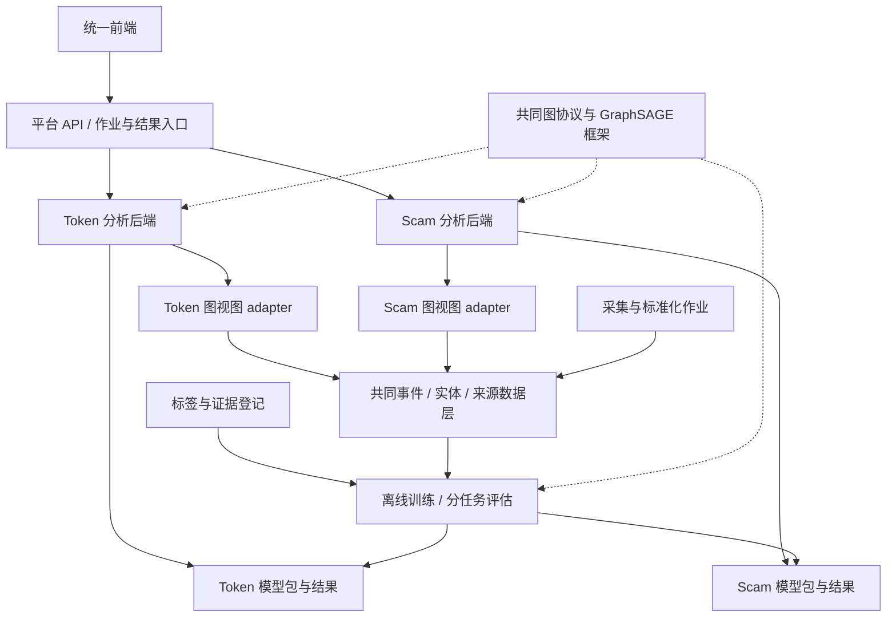

# 风险分析平台工程方案与自采数据指导

日期：2026-10-05；版本：platform-engineering-0.1。

本文细化 [系统需求与架构](SYSTEM_REQUIREMENTS_AND_ARCHITECTURE.zh-CN.md)，明确统一前端、两个分析后端、共同图协议/GraphSAGE 框架、独立实验结果的实现边界，并提供自采、整理与标注数据的执行指导。状态为设计合同，接口、目录结构与样例均是拟实施方案，不表示服务或采集已经运行。

## 1. 项目定位与原 Canvas 的关系

**工程目标：上线一个 Ethereum 风险分析平台，为用户提供代币活跃性分析和链上诈骗行为分析。** 两类任务分别调用业务后端，复用数据基础设施和训练工具，通过同一个前端访问。研究层面分别保留任务的数据分析、基线、性能结果和适用边界。

需要区分两条演进线：

| 视角 | 原有内容 | 此次新增/整合内容 |
|---|---|---|
| 原 Canvas 的任务范围 | Scam 检测：链上交易图、特征/图模型、GraphSAGE、评估及可选预训练 | 新增代币活动预测作为另一类下游任务，扩展为统一平台 |
| 当前代码资产 | `ds-crypto-project` 已实现 token 数据工程与 GraphSAGE 实验 | 补齐 Scam 数据 adapter、任务训练/推理后端，再接共同前端 |

因此，“原 Canvas 技术路线基本覆盖 Scam 下游任务”在**方法路线**上成立。它仍需数据版本验收、标签治理和后端工程，不能等同于已实现完整诈骗服务。Canvas 的链接预测预训练是可选方法实验，不是平台集成的先决条件；Honeypot 卖出限制还需图之外的独立证据。

本文保留现有任务编号：A 为 token activity，B 为 scam screening。编号来自当前仓库合同，不表示研究提出的先后顺序。Task A 的 7 天输入、随后 90 天结果、USD 1,000 阈值及主 split 不变。

## 2. 后端边界：两个业务服务，共用底层能力

推荐将两个分析后端设计为**可独立调用、测试、版本化和部署的服务边界**。课程/首期部署可以是同一代码仓库中的两个应用模块或 worker；需要依赖隔离、不同资源或独立扩容时，再运行成两个进程/容器。统一入口只做路由、作业状态和结果聚合。



| 组件 | 职责 | 不承担的职责 |
|---|---|---|
| 平台 API | 请求校验、task 路由、request/job id、缓存、状态、结果索引 | 重新解释业务标签或把分数混成一个概率 |
| Token 后端 | 检查任务适用性、冻结 7 天窗口、调用 token 图/模型、返回活动结果 | 用低活动分判诈骗 |
| Scam 后端 | 分发 phishing/Ponzi/Honeypot 分支，调用各自图模型及证据检查 | 因与恶意地址交互就给所有关联实体贴标签 |
| 共同数据服务/库 | 事件与实体规范、raw lineage、按时间读取、质量元数据 | 替两个任务规定同一个观察窗或标签 |
| 共同 ML 包 | tensor/批处理、MeanSAGE、训练循环、checkpoint、指标和预测接口 | 强迫使用同一个 scaler、权重或特征维度 |
| 离线训练作业 | 读取冻结快照、监督标签与 split，评估后提交模型包 | 在用户查询请求中边预测边训练 |

一个任务超时或模型不可用时，平台应返回该任务的明确状态，其他成功结果仍可展示。两个后端使用共同错误码和结果 envelope，但各自提供 payload schema。两个后端分别保存模型版本和健康状态，共同库固定依赖版本，避免升级公共代码后静默改变旧模型输入。

建议入口是 `POST /analyses`，请求包含 chain_id、address、task_ids、as_of；由平台调用内部 `token/analyze` 或 `scam/analyze`。异步作业返回 id，再用 `GET /analyses/{id}` 读取。缓存/幂等键至少覆盖任务、实体、cutoff、graph/feature/model 版本与证据版本；不能仅按地址缓存所有分析。

## 3. “共用图数据结构”的准确范围

可以统一**图容器、字段协议、序列化、校验器与批处理接口**。同一原始事件库可以派生不同任务的图；并不要求它们是相同的拓扑，也不要求构成一张全局图。

| 层次 | 共用 | 分任务定义 |
|---|---|---|
| 物理身份 | `(chain_id, address)`，事件唯一标识 | token/pool/participant/contract 等角色 |
| 图容器 | nodes、edges、root、cutoff、schema、quality、lineage | 节点类型集合、边关系、窗口、跳数、抽样 |
| 数值张量 | `x`、`edge_index`、可选 `edge_attr`、mask、root index | feature_names、单位、维度、scaler、类型字典 |
| 模型接口 | `encode → readout → task head` | head 输出、模型权重、校准/阈值 |
| 图展示 | 节点/边通用渲染组件 | 颜色图例、关系解释、证据与权限范围 |

Token 图仍为 wallet—pool—token；Scam 图主要是地址间 transfer/call 关系。pool membership 不是资金流边；ERC20 Transfer 与 Swap 不是重复命名的同一事件。当前图保存 edge attributes，不代表现有 MeanSAGE 消费了这些属性。

建议共同图协议的逻辑结构如下，落地时再生成正式 schema：

```text
GraphSample
  sample_id, task_id, chain_id
  target_entity_id, root_node_index
  feature_start, feature_cutoff, data_snapshot_id
  graph_schema_version, graph_view_version, feature_schema_version
  nodes: local_id, entity_id, role, attributes, missing_mask
  edges: src_local_id, dst_local_id, relation, direction, attributes, lineage_ref
  quality: coverage_scope, completeness, truncation, missing_fields
  sampling: hops, per_relation_budget, seed

SupervisionRecord                  # 单独保存，在线推理不要求存在
  sample_id, task_id, label, label_status, label_version, split
```

`GraphSample` 到张量的 adapter 应验证边端点、root 索引、特征顺序/维度/单位、时间范围和模型兼容版本。不能只检查维度相等。当前 token root 为首节点的约定保留；通用框架增加显式 root index，兼容旧样本。

公开数据若只有匿名整数节点 ID，可在该数据源内训练；**没有可靠映射时不能与自采地址图强行 join**。同样，缺少绝对时间的处理图只能作为单独静态 benchmark，不能伪装成实时输入。这不妨碍共用训练框架，但限制共享数据和 checkpoint。

## 4. 共用 GraphSAGE 训练框架的组织

首期不需要更换已有原生 PyTorch 实现。先把脚本中任务无关的部分抽出来，再通过 adapter 和配置承接两类任务。

```text
packages/
  chain_data/        # 身份、事件、时间、来源、去重、读取接口
  graph_core/        # GraphSample、校验、序列化、采样与 tensor 转换
  gnn_core/          # MeanSAGE、batch、训练循环、预测、checkpoint
  evaluation/        # 指标、分组评估、校准工具、报告格式
tasks/
  token_activity/   # 原 token 规则、图视图、特征、标签、head/config
  scam/             # phishing、Ponzi、Honeypot adapters 与证据逻辑
services/
  gateway/
  token_backend/
  scam_backend/
frontend/
```

这是建议的职责划分，不要求一次性移动所有旧文件。旧 CLI 可作为兼容入口调用新模块；先用已冻结的小型输入核对特征和分数，再替换调用路径。旧脚本/报告保留，以免重构导致历史实验失去可追溯性。

必须先做的接口变化：当前 `graph_tensor()` 要求 label，训练类枚举也固定于 active/dead。抽取 label-free tensor 函数和 `predict()`；训练 collator 单独读取 SupervisionRecord。共同 trainer 接收 task config，明确 positive_label、readout、loss、class weights 与 metrics，不把 Scam 接入写成 active/dead 的别名。

每个模型包独立包含：权重、feature schema、graph version、类型/关系字典、scaler、head、标签极性、阈值/校准器、训练快照及代码版本。训练框架复用与共享预训练分别验收；前者即可体现项目一致性，后者只在独立基线可靠后考虑。

## 5. 统一前端与独立结果

建议前端有三个访问区：代币分析、诈骗分析、研究结果。可以共用地址输入与实体详情，但必须让用户知道当前选择的任务。

| 页面 | 主要内容 |
|---|---|
| 代币分析 | 所选 pools、前 7 天活动、后续低交易量分数、图、数据时间、模型版本、尚未满足的输入条件 |
| 诈骗分析 | 目标角色、phishing/Ponzi/Honeypot 各分支状态、分数与证据、限制条件、局部资金/调用关系 |
| 研究结果 | 按任务和 run 筛选：数据覆盖、类别统计、EDA、基线、PR/ROC、混淆矩阵、误差案例、模型版本 |
| 实体详情 | 关联两类分析的入口及历史快照；各结果保持自己的窗口和含义 |

空数据、抓取失败、标签未知、模型未提供、训练结果尚未成熟，不能统一画成绿色“正常”。真实推理结果与演示样例明确标识；界面通过相同 request id 关联图、结果和证据。任务 A 的 7 天特征图与任务 B 的 trailing-window 图即使展示同一地址，也应显示各自时间范围。

### 5.1 实验与性能结果如何保存

保留现有 `reports/model_comparison_*.md` 路径，不重写其历史数值。新增结果按 task/run 归档，在线 assessment 与离线 benchmark 分开：

```text
reports/<task_id>/<run_id>/
  data_card.md
  eda.md + figures/
  comparison.md
  error_analysis.md

artifacts/<task_id>/<run_id>/
  run_manifest.json
  dataset_manifest.json + split_manifest.*
  predictions.* + metrics.json
  model_package/
```

这些新路径是设计示例，尚未创建实验结果。大数据/模型可放外部工件存储，Git 保留 manifest、校验值与报告；不得把凭证写入 manifest。

每个结果至少绑定 task、label version、数据快照、来源/采样、实体支持数、cutoff、split/group、feature/graph version、seed、代码 commit/工作区补丁标识、阈值选择过程及实际资源消耗。平台结果页读取已批准的报告索引，不根据测试结果不断自动挑“最好模型”。

Token 和 Scam 分别保留数据分析与性能表。平台可汇总每任务状态和指标名称，但不能把不同标签、基率和难度的 AP 平均成“整个平台准确率”。平台自身另外测 API 可用性、各阶段 p95、抓取覆盖/滞后、失败恢复等工程指标。

## 6. 自采、整理、标注：分项可行性

自采数据总体可行，但难度差异很大。下面是工程判断，不是已经测得的成功率。

| 工作 | 可行性 | 主要瓶颈 | 推荐边界 |
|---|---|---|---|
| 固定协议/pools 的 Swap、Mint、Burn、Transfer 日志 | 高 | RPC/索引覆盖、分页、去重、ABI 和金额单位 | 单链、协议 allowlist、限定时间与实体 |
| 种子地址的外部交易与 token 转账历史 | 中高 | 地址历史需要索引服务或自行索引 | 小批地址、分块/分页、存原始响应 |
| 完整内部调用、历史状态、失败路径 | 中 | provider 的 trace/历史保留能力与请求成本 | 对必要案例补充，不默认全链全量 trace |
| 自动生成 token 低活跃性标签 | 高，但有延迟 | 90 天完整随访与历史 USD 口径 | 历史 cohort 先行；新 token 持续跟踪 |
| 独立标注 phishing/Ponzi 正例 | 中 | 角色、机制、证据时间、来源复核 | 公开种子 + 历史补数 + 审核 |
| 标注普遍可信的“正常地址” | 低于采集本身 | 没有被举报不证明无恶意 | 明确负例标准；否则保留 unlabeled |
| 自动大规模标注 Honeypot | 中低 | 条件/状态依赖、失败原因歧义 | 固定条件模拟 + 机制证据；不确定就弃权 |

最现实的路线是：**公开数据建立基线，自采数据补齐可追溯的历史/线上输入，可靠标签逐步积累。** 一开始完全自行发现并人工标注大规模多类别诈骗数据，容易把主要精力耗在标签调查，而无法完成模型对照与平台交付。

## 7. 采集从哪些接口开始

| 需求 | 可用入口 | 必须注意 |
|---|---|---|
| 固定合约事件 | Ethereum `eth_getLogs`，按 block range、合约和 topics 筛选 | filter 中 address 是日志发出合约；不是任意钱包的全部历史 |
| 区块、交易与执行状态 | block/transaction/receipt RPC | 外部交易 input、receipt status、logs 分开；失败交易不产生可当成功转账的持久日志 |
| 按地址查历史 | Etherscan V2 等索引 API，或自己的索引 | normal、token transfers、internal 分别查；没有一个普通 RPC 能直接返回地址全部历史 |
| DEX 结构化数据 | 现有 Uniswap subgraph / The Graph collector | 记录 deployment、schema、索引区块和分页；保留 raw 与 lineage |
| 调用/历史状态 | provider trace/debug 或具备相应历史能力的节点 | 读到历史日志不代表能执行该历史区块的状态调用或 trace |

官方入口：[Ethereum JSON-RPC](https://ethereum.org/developers/docs/apis/json-rpc/)、[日志接口](https://ethereum.github.io/execution-apis/api/methods/eth_getLogs/)、[Etherscan normal history](https://docs.etherscan.io/api-reference/endpoint/txlist)、[internal history](https://docs.etherscan.io/api-reference/endpoint/txlistinternal)、[The Graph 查询文档](https://thegraph.com/docs/en/subgraphs/querying/graphql-api/)、[Geth tracing](https://geth.ethereum.org/docs/developers/evm-tracing/basic-traces)。

2026-10-05 核对的 Etherscan 文档仍列出了 V2 地址历史及分页接口。具体账户可用的链、端点、分页上限、历史范围和速率应做 capability probe，不能从旧采集脚本或网页示例推断。响应 `status=0` 可能是无记录也可能是错误；要解析具体错误和分页状态，不能一律当空历史。[Etherscan internal API](https://docs.etherscan.io/api-reference/endpoint/txlistinternal)、[速率限制](https://docs.etherscan.io/rate-limits)

对当前 token 任务，**RPC 原始日志不自带 `Swap.amountUSD`**。直接改用 RPC 后，自行估算价格不能冒充原 subgraph 的历史 USD 字段。首期继续保留既有来源与口径；如改为新的历史定价规则，需单独来源/标签版本、缺失处理及匹配样本验证。小池的 spot price 也可能被操纵，不能当作无误差真值。

### 7.1 一个可靠采集器应有的流程

1. 冻结 chain、协议/pool 或种子列表、时间范围、事件类型、字段和 source version；先查 provider capability。
2. 将时间窗口映射到确定区块边界，以 finalized 数据或明确确认策略为准；保存 block hash。
3. 用小 block range/页开始读取；超时或命中上限时缩小区间，指数退避并带随机抖动。单个区块仍超限则细分过滤或采用可靠分页，不能跳过该块。
4. 每页原始响应落盘并写 manifest，校验后再推进游标；重复执行幂等。接口失败不推进到“已完成”。
5. 对重叠区间重取并去重；校验哈希变化或 removed 事件，撤销旧 canonical 结果后重新生成派生表。
6. 每个实体/窗口输出 coverage 记录：请求范围、返回范围、成功页、缺口、缺失字段、截断与未覆盖事件类型。空记录与未抓到分开。
7. 做少量第二来源/receipt 对照：事件数、金额方向、block/time、最终页及 raw→normalized 行数差异。接入新 provider 后重复此检查。

对外部交易、ERC20 日志和内部调用分别使用 `(chain_id, tx_hash)`、`(chain_id, tx_hash, log_index)`、`(chain_id, tx_hash, trace_path)` 作逻辑键。原始存储另保留 block hash 和 canonical 状态以处理重组。normal transaction 与根 trace 可能描述同一 ETH 转账，资金统计必须消除跨视图双算。

初期不建议自建完整归档节点。先使用有限范围的数据源和有历史能力的 provider，只有反复出现成本/覆盖瓶颈再比较自建成本。历史状态与 tracing 能力依赖节点配置与保留策略，不能只凭“full node”名字判断。[Ethereum 节点说明](https://ethereum.org/developers/docs/nodes-and-clients/)

## 8. 如何整理成可训练的数据

使用四个分离层次：

1. **事实层**：不可变 raw bundle、normalized events、实体角色、历史状态及来源。
2. **证据层**：外部报告/列表/规则/模拟结果；包含涉及角色、有效时间、获知时间及原始标签。
3. **监督层**：按任务与样本 cutoff 审定的 label、label status、证据引用、版本和冲突处理。
4. **实验层**：冻结 cohort/split、特征、图、训练与预测工件。

事实层不放 `is_scam` 这种没有来源和任务含义的全局真值字段。原始 token amount 保留整数或足够精度的十进制表示，模型变换另外存；缺 decimals、USD、时间、角色时显式 missing。钱包跨池累计统计也只能使用该样本 cutoff 前的信息。

建议自采 pilot 交付四张检查表：source capability、coverage、label evidence、sample eligibility。仅当事件覆盖符合任务声明、字段可解析、标签语义和时间可用时，样本才进入该监督任务；不满足的样本仍可以在事实库或质量表中保留。

## 9. 如何标注：四种任务分别处理

### 9.1 Token activity：可以程序化生成，但必须等结果成熟

固定候选池，保存 t0，冻结前 7 天输入。cutoff 之后完整 90 天结束，再按原合同的 selected-pool swap 历史 USD 总量生成标签。无交易且覆盖已证明完整，可以是低交易量；无法抓到交易不等于无交易。缺少可靠 USD、范围或随访时维持 censored。

存储 `feature_cutoff`、`followup_end`、`label_available_at` 和证据快照。训练时要求结果已成熟且标签在 training_as_of 可用。历史 token 可立即回溯构造训练样本；现在新发现的 token 只能先进入前瞻推理队列。

### 9.2 Phishing：实体角色与时间是关键

先从有出处的公开列表/事件报告提取种子，但视为 candidate label；记录原始依据、攻击/收款/受害角色、事件时间和发现时间。用相关交易与独立材料核对，尽量由两次独立审查或两名审核者检查争议/关键测试样本；同一数据库的转载不算两个独立来源。

可审核的正例依据是特定攻击者/诈骗收款角色的证据，不是“距离某地址两跳以内”。风险列表只有 `involved` 或没有时间信息时保留源标签，先做受限 benchmark，不能升级为已证实攻击者或提前预警标签。

### 9.3 Ponzi：机制标签与交易行为相互印证

优先采用已有研究的合约标签，核对地址/链与重复冲突，再补相关历史交易。新的自标正例应有代码/执行或调查材料支撑的资金与承诺机制；循环资金、返款网络或高收益宣传单独都不足以完成标签判定。

如果无法审核机制，只保留 `ponzi_candidate` 作为待审证据，不加入确定正例。老合约使用与标签相关的历史窗口；不能给今天已经无交易的空图贴上旧时期的正标签作为当前检测训练样本。

### 9.4 Honeypot：优先标可观察限制，谨慎解释恶意

在固定 block 的隔离 fork 上检查指定 route、账户、余额、allowance、数量、滑点和买入/授权/卖出序列；保存成功/失败以及原因。独立重复、改变合理条件并检查相关机制，有助于排除普通失败。

“该条件下卖出受限”是可测试事实；“蓄意诈骗”需要额外语境与机制依据。分别记录 `restriction_observed`、`simulation_inconclusive`、来源诈骗 subtype 及最终审核标签。图模型不以自身高分给自己生产监督真值。

### 9.5 负例、未知和弱标签

未知默认 unlabeled。没有名单记录、某次可卖出、交易持续活跃，都不能单独证明一般意义的正常。负例标准按任务定义，并尽量匹配正例的年代、实体类型、协议与活动规模；匹配产生的抽样偏差也要在报告中说明。

建议标签状态沿用 scam 合同的 supported_positive、supported_negative、unlabeled、disputed、invalid、temporally_unresolved。另加 evidence_strength（如审核/来源标签/规则弱标签）与 decision rationale。弱标签实验独立命名、独立报告；正式测试集尽量采用经复核且无来源冲突的样本。

主动学习可以把高不确定性、来源冲突或模式新颖的样本放进**训练候选审核队列**；审核预算和选择概率入库。不要只验证高分样本就估计总体 precision/recall，也不要把测试集持续反馈给训练。

## 10. 建议的最小自采试点

以下数字是用于验证管线的建议规模，不代表足够训练或统计功效，也不改变 Task A 全部合格样本的正式采样合同。

| 阶段 | 建议动作 | 输出/继续条件 |
|---|---|---|
| 第一步：约 1–2 天的访问与字段检查 | 选一个协议，10–20 个历史 token；选 20–50 个有证据的 scam 地址/合约种子，覆盖几种活动规模 | 确认分页、receipt/trace 可得性、历史 USD、字段与成本；失败路径能正确标记 |
| 第二步：小样本整理 | 构建 raw→events→GraphSample；保留真实无记录、缺失字段、失败请求等案例 | 能重建同一图；所有选用事件有来源；cutoff 检查通过 |
| 第三步：标签审核 | 历史 token 自动标签；诈骗候选逐条记录证据与角色；负例/未知分开 | 抽查标签能回溯；冲突隔离；输出 label coverage 与不可用原因 |
| 第四步：受控扩大 | 扩大历史合格 cohort，优先完成一个 scam 分支；新 token 持续采集但等待成熟 | 请求/存储预算可控，缺口率/标注成本可接受，再训练基线 |
| 第五步：上线验证 | 两后端各处理真实无标签输入，统一前端展示；持续记录前瞻结果 | 能区别失败与低分、完成重试/回滚；标签成熟后单独评估 |

预算先测量再估计：`总请求量 = 各实体各事件源分页请求 + receipts + 必需 traces/state + 重试`。原始数据按事件/响应实际大小估存储，训练按采样后的节点/边估内存。图扩展规模大致随每跳 fanout 相乘；配置每关系邻居上限、最大 hop 与边数，截断情况进入 quality，不称完整全图。

标注成本可用“每小时审核实体数 × 需审核实体数 + 争议复核时间”估算。通常软件自动化能显著降低采集整理成本，但无法同等降低可靠诈骗真值的调查成本。优先为小型、独立的测试集保留较高质量审核，再决定是否引入大规模弱标签训练。

## 11. 首期工程验收清单

- 同一前端能选择两类任务，并调用各自后端；一个后端失败不伪造另一类结果。
- 两类任务都通过同一 GraphSample 校验与共同训练/预测接口，但模型包保持独立。
- 使用无 label 的新输入完成推理；不足 7 天的 token 与不适用的 Scam 任务有明确状态。
- 每任务数据卡、EDA、split、基线、预测与指标可单独访问；历史报告数值不变。
- 自采数据可从图追溯到原始事件；分页失败、缺口、重组与历史能力不足均被记录。
- 标签可追溯到依据与时间；unknown、冲突、censored 不被转成正常。
- 数据/模型/特征版本匹配；完成请求去重、限流、失败重试与版本回滚验证。

平台集成完成与模型有效性分别验收。独立后端加统一前端、共同图/训练框架及独立结果归档，已经构成有组织的工程项目；不必依赖“所有任务共用一套权重”来证明整体性。
