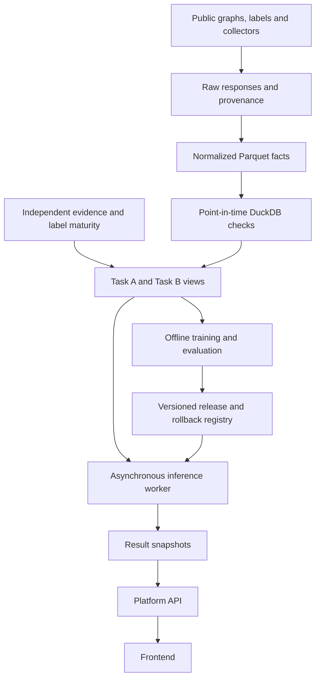

# Ethereum behavior and risk analysis: requirements, feasibility and architecture

Version: system-scope-0.2; adopted: 2026-10-05. English/status update: 2026-10-09.
This is the adopted system design. Task B offline data/graph and Phishing/Ponzi
training code now exist; Honeypot/v2 Rug are data-only. Online services and joint
training remain unimplemented. Historical report metrics are documentary
evidence, not newly reproduced experiments.

The [platform guide](PLATFORM_ENGINEERING_AND_DATA_GUIDE.md) specifies a common
frontend, independent Token/Scam backends, graph/GraphSAGE protocols and separate
analyses/results. Scam was the original Canvas downstream task; token activity
was added. Relative to repository assets, token code existed first and Task B
extends that codebase. This does not rewrite the origin of the Canvas task.

## 1. Decisions and five questions

The unified system has two families: subsequent low-volume token outcomes and
classic scam patterns. Entity/event/time/graph foundations, experiments and
future evidence interfaces are shared; labels and outputs remain independent.

| Question | Decision | Boundary |
|---|---|---|
| Retain Ponzi, Phishing and Honeypot with graphs? | Yes; deliver by data admission, initially prioritizing Phishing then Ponzi. V2 Rug was formally added on 2026-10-08 | Tasks overlap; sell restrictions need state/rule/simulation evidence beyond graphs |
| Adapt TrxLLM to GraphSAGE? | Reuse target-centered bounded attributed account graphs | BPE, edge-aware GIN, Transformer and masked pretraining are different methods requiring adaptation/ablation |
| Static public data plus live collection? | Recommended | Live U is not benign, old labels do not apply to arbitrary windows, new token outcomes mature around day 97 |
| Integrate/deploy? | Future unified queries, monitoring, evidence and screening | No verified production service; continuous collection is not instant foresight, live training or pre-transaction blocking |
| Keep two GraphSAGE families coherent? | Share code/protocols/evaluation; independent models | Architecture does not imply common topology/weights/probability; shared encoders are a testable later experiment |

The research question is whether bounded neighborhood behavior adds value across
distinct tasks under an auditable point-in-time framework. Activity predicts
future outcomes; initial scam tasks identify patterns at cutoff. Early-warning
claims require incident onset, strict lead times and separate labels/evaluation.

## 2. Evidence and maturity

Earlier repository-route discussions were checked against actual files. Chat
descriptions do not replace code, manifests or results.

| Asset | Evidence | Supports | Does not establish |
|---|---|---|---|
| Token contract | [Goal](../GOAL.md), [contract](../CONTRACT.md), [sampling](COHORT_SAMPLING_AND_CLASS_BALANCE.md) | First-week behavior and subsequent 90-day volume | Price, fraud or permanent death prediction |
| Data engineering | [Workflow](DATA_ENGINEERING_WORKFLOW.md), `scripts/build_data_product.py`, `sql/model_tables.sql` | Raw/Parquet/DuckDB/SQL batch pipeline | Production streaming/full live coverage |
| Wallet graph | [Input contract](GRAPH_WALLET_INPUT_CONTRACT.md), `scripts/build_wallet_graph.py` | One graph/token, roles and edge attributes | Wallets identify people or all stored fields are consumed |
| Original GraphSAGE | [Trainer](../scripts/train_graphsage.py) | Native two-layer mean aggregation, root readout, disconnected graph batches | PyG heterogeneity, temporal GNN or consumed edge text/attributes |
| 2026-10-03 report | [Wallet experiment](../reports/model_comparison_wallet_graph_general_stratified_20261003_v1.md) | Reported 2,000 tokens, 988,383 normalized events, three seeds | Local reproduction or whole-chain/scam generalization |
| Canvas research | [Feasibility](../../researches/Canvas-Feasibility-Analysis.md), [audit](../../researches/Data-Source-Audit.md) | Public routes and concrete data problems | Every full graph downloaded, rights resolved or permanent API quotas |
| TrxLLM | [Review](TRXLLM_REFERENCE_REVIEW.md) | Graph/UI ideas | Supplied proprietary data/backend/checkpoints or full reproducibility |
| Task B code | [Release guide](TASK_B_IMPLEMENTATION.md) | Offline pipeline/model interfaces and synthetic checks | Real trained models, research results or services |

Complete historical training data/checkpoints and the referenced
`config/label_specification.json`, `config/event_schema.json` and
`config/market_context_schema.json` are absent locally. Recover/version them
rather than inventing past specifications or claiming acceptance.
`config/model_split.json` remains unchanged.

### 2.1 Interpreting historical performance

The 2026-10-03 test cohort had 209 tokens: 99 continued_activity and 110 low_volume_dead.

| Metric | Wallet GraphSAGE main seed | Matched Logistic Regression |
|---|---:|---:|
| ROC-AUC, active positive | 0.9478 | 0.9348 |
| AP, active positive | 0.9344 | 0.9327 |
| Dead recall, native threshold | 0.8636 | 0.9182 |
| Dead precision, native threshold | 0.8796 | 0.8347 |
| Dead classified active | 0.1364 | 0.0818 |

The pipeline has an implementation basis, but an AP difference of 0.0017 does
not prove significant graph superiority. Thresholds trade false positives and
misses; three seeds reuse one test set, not three independent validations.
Older 1,042-sample test AP is not directly comparable.

The frozen 1,000/1,000 pilot differs from the current all-eligible, probability-
and group-aware cohort contract. Verify its candidate frame/selection and do
not interpret balanced prevalence as market incidence. Preserve history and
validate a compliant new cohort. Since the old test has informed decisions,
further tuning needs a new final holdout.

## 3. Task definitions

### 3.1 Task A: subsequent low-volume token outcome

- Ethereum token contract within preselected DEX/pools.
- t0 is earliest selected-pool creation, with the documented first-activity fallback only if unavailable.
- Features use `[t0, t0 + 7 days]` under existing inclusive-boundary rules.
- Outcome uses the complete subsequent 90-day selected-pool historical `Swap.amountUSD`: below USD 1,000 is low_volume_dead, otherwise continued_activity.
- Only swaps count toward outcome volume; Mint/Burn can be liquidity features. Transfers, airdrops and price changes do not define this label.
- Incomplete follow-up/retrieval/pools or missing usable positive historical swap USD stays censored, never an imputed class.
- Preserve label/launch-period-stratified 80/10/10 with overlap groups intact. Chronological splits are secondary; prospective evidence is a separate release gate.

The historical name low_volume_dead means subsequent 90-day low volume, not scam,
inevitable zero price or permanent inactivity. Longer 180/365-day studies require
new label versions and mature follow-up.

### 3.2 Task B: independent classic scam tasks

The [scam contract](SCAM_TASK_CONTRACT.md) defines independent binary tasks.
Entities can have several supported labels; missing task labels are masked.

| Task | Entity/label | Graph evidence | Limitation | Current delivery |
|---|---|---|---|---|
| Phishing | Address with evidenced malicious role | Funds concentration, bursts, repeated counterparties, neighborhood | Victims/exchanges/routers interact with malicious entities; U is not verified benign | Address egographs and graph/tabular train/evaluate code |
| Ponzi | Contract and supported mechanism | Contributions/refunds, repeated payments, participant hierarchy | Topology alone cannot prove new-money-to-old-investor mechanism | Contract graphs and independent model code; code rules separate |
| Honeypot | ERC20 deceptive sell restriction | Buy/sell patterns, failures, liquidity/control | No sells or one revert is inconclusive; allowance/balance/slippage/routes matter | Evidence/data/initial graphs only; simulation/model deferred |
| Rug Pull v2 | Token with verified Uniswap v2 pool and malicious withdrawal evidence | PairCreated/Mint/Burn/Sync/LP flows and funds attribution | Withdrawal, reserve decline or inactivity alone is not fraud | Evidence/data/initial graphs only; v3 and other mechanisms excluded |

Contract exploit lures and ERC20 sell restrictions need separate subtypes.
Defensive honeypots or merely unpopular tokens do not supply fraud labels.
Insufficiently supported branches report unready/case-study status, not another
task's labels or fabricated trained scores.

### 3.3 Relationship between activity and scam dimensions

| Activity | Scam evidence/pattern | Interpretation |
|---|---|---|
| High low-volume risk | Insufficient evidence | Demand, launch failure or market changes; no fraud inference |
| Likely active | Strong scam evidence/pattern | Continued trading can coexist with malicious control/manipulation |
| High low-volume risk | Strong scam evidence/pattern | Review both independently |
| Any | Missing/inapplicable | Unknown/unsupported, not safe |

This is an information system, not summed universal safety probability. An
explicit review-priority policy can rank cases, but is neither probability nor
new unvalidated supervision.

## 4. Requirements and acceptance

| ID | Requirement | Check |
|---|---|---|
| FR-01 | Common entity entrypoint | Chain/address/roles/as_of validation and unsupported statuses |
| FR-02 | Activity | Seven-day input, insufficient-history status, 90-day meaning/version |
| FR-03 | Four scam tasks | Task cards/evidence/entities/independent versions; no fabricated unready scores |
| FR-04 | Historical/incremental data | Raw snapshots, keys, paging, block hashes, missingness/reorg provenance |
| FR-05 | Evidence graphs | Relation/direction/time/source/sampling and edge-to-event lineage |
| FR-06 | Separate training/inference | Label-free inputs; admitted mature supervision only |
| FR-07 | Risk cards | Independent activity/pattern/rule/source/coverage outputs |
| FR-08 | Monitoring | Durable cursors, retries, deduplication/lag; changes rematerialize, not relabel automatically |
| FR-09 | Release/rollback | Matched schema/graph/scaler/weights/threshold/calibration and whole-bundle rollback |
| FR-10 | Independent backends/archives | Separate calls/versions, common UI, per-task EDA/models/predictions |
| NFR-01 | Reproducibility | Same snapshot/config/seed, bound versions/checksums |
| NFR-02 | Time | Event/known-at/retrieval times separate; no future features |
| NFR-03 | Uncertainty | Missing is not zero; censoring/U/conflict/unsupported separate |
| NFR-04 | Cost/performance | Cache/cold collection/graph/inference p50/p95 and bounded queue/graph/API budgets |
| NFR-05 | Service | Read-only, server credentials, input/rate/failure/log checks |

Required delivery excludes multichain, arbitrary transaction classification,
function-name recovery, automated trading and general large-model pretraining.
Other chains need independent data/label admission despite similar addresses.

## 5. Shared facts, task-specific views

### 5.1 Logical tables

Extend the [data workflow](DATA_ENGINEERING_WORKFLOW.md). These are logical
responsibilities, not a claim every table/service exists.

| Table/artifact | Fields/responsibility |
|---|---|
| entities | Chain/address identity and concurrent time-bounded roles |
| events | Block/hash, transaction, log/trace identity, type, endpoints, asset/raw amount/decimals/status/time/source/retrieval |
| event_roles | Explicit sender/recipient/origin/deployer, no silent substitution |
| state_snapshots | Balance/nonce/code at specified block, not current-state backfill |
| source_evidence | Source/ref/summary, valid/known-at time, block, confidence, rights |
| task_samples | Task/entity/cutoff/window/view/quality/sample id |
| task_labels | Sample/task/value/status/availability/onset/version/conflicts |
| split_manifest | Entity/campaign/group partition and cross-task holdout audit |
| graph_artifacts | Features/root/types/direction/time/sampling/event lineage |
| model_registry | Input contract/scaler/threshold/calibration/data/time/metrics/code/domain |
| assessments | Per-task result/status/cutoff/version/evidence/coverage/generation time; append history |

Swap, Transfer, external transactions and internal calls are distinct. One swap
can have several transfers; avoid double counting. Logs/traces have separate
keys, not transaction-only deduplication. ETH/wei/token raw/historical USD stay
separate; do not sum raw units across assets.

Confirmation time differs from retrieval. Historical immutable facts can be
reconstructed later if their historical existence is proved. External risk
labels, ABI annotations and price revisions need known-at rules; today's flags
cannot become past features. Unproven availability excludes strict early-warning
inputs or explicitly limits the benchmark.

### 5.2 Data paths

| Path | Use | Prohibited shortcut |
|---|---|---|
| Public labeled/static graphs | Pilots, algorithms and historical cases | Unchecked joins, U-as-benign or full-history early-warning claims |
| Public labels + historical chain data | Entity/time-aligned auditable egographs | Old Ponzi labels on today's empty 30-day graph |
| Incremental facts | Inference, coverage/drift, later mature labels, controlled unsupervised experiments | No-alert-as-normal or self-generated score-as-truth |

Streaming is an append-only fact store; training uses frozen snapshots/versioned
labels and offline release gates. Truth needs independent review; self-supervision
respects time/holdouts. New-token features mature by day seven and outcomes around
day 97 plus indexing/review delay. A five-week demo cannot validate all outcomes
for tokens launched during those five weeks.

### 5.3 Sources and selection

Counts below come from the **saved 2026-09-21 audit**, not newly downloaded full
datasets. See [source audit](../../researches/Data-Source-Audit.md) for checksums
and the distinction between inspected and uninspected resources.

| Source | Known resource | Use | Admission |
|---|---|---|---|
| XBlock Phishing id=13/6/9 | id13: 2,973,489 nodes, 13,551,303 edges, 1,165 positives; id6 negatives explicitly U | Select one version by resources | Load/fields/units/time/U semantics, seed-neighborhood bias, rights |
| XBlock Ponzi id22 | 3,793 rows: 200 positive, 3,590 zero, 3 errors; no transaction graph | Historical label seeds | Exclude errors, collect external/internal history, review negatives/time |
| Unica | 182 unique addresses, code/collector, no full histories | Ponzi cross-checks | Two XBlock conflicts; separate code/data terms |
| TokenScout | 214,084 labels, including 22,800 Honeypot and 9,483 Ponzi in source taxonomy | Later token-scam comparison | Integer IDs/transformed values/time need verified reversal and rights |
| Forta | Ethereum phishing/malicious-contract CSVs and source fields | Additional seeds/evidence | Involved is not attacker, copied labels not independent truth; review roles/time/source duplication |
| Self-collected chain data | Controlled windows/scope/quality/incremental process | Long-term fact backbone | Measure coverage/paging/rates/history cost; retain provenance/failures |

[Forta repository](https://github.com/forta-network/labelled-datasets) supplements
links preserved in the old audit. Historical reachability is not permanent
availability. Start with one Phishing version, pilot dozens of Ponzi histories,
and freeze Honeypot evidence before choosing TokenScout or reviewed cases.
Record internal-use and redistribution rights separately; public repositories
do not automatically authorize every upstream dataset's redistribution.

## 6. GraphSAGE reuse and method choices

### 6.1 Share infrastructure, preserve semantics

| Layer | Shared | Task-specific |
|---|---|---|
| Collection | Envelopes, address normalization, deduplication, time, provenance, Parquet | DEX, transfer and trace adapters |
| Graphs | Cutoffs, budgets, sampling, explicit root, lineage and quality | Wallet/pool activity, address funds/calls, token evidence |
| Features | Count, gap, concentration and missingness helpers | Units, types, assets, windows and parameters |
| Models | Native MeanSAGE, batching and train/predict interfaces | Weights, scaler, threshold and calibration |
| Evaluation | Split audits, PR/ROC, intervals and errors | Polarity, prevalence, review budget and acceptance threshold |
| Serving | Entity queries, statuses, graph/evidence versions and history | Score meaning, eligibility and explanation |

Pool membership is structural; an asset transfer records movement. The same
physical address may hold several roles, but preserve Task A v0.1 identities
and use cross-view entity mappings instead of rewriting historical nodes.
[GraphSAGE's inductive design](https://snap.stanford.edu/graphsage/) requires
compatible input features; it does not guarantee transfer across chains,
tasks or eras.

### 6.2 Separate graph storage from model consumption

Task A's existing graph tensor converter couples labels, node features and
edge indices. Add a label-free converter and a supervision collator without
changing its historical scripts. MeanSAGE's basic update is:

```text
h_v^(k+1) = ReLU(W_self h_v^k + W_neighbor mean({h_u^k: u in N(v)}))
```

A two-layer root readout can cover wallet/pool/token paths. Collecting more
hops does not expand a fixed model's receptive field. Sampling may discard
small but informative edges; report truncation and stability.

| Variant | Method | Boundary |
|---|---|---|
| M0 | Node-feature MeanSAGE | Fast baseline; node amount/time summaries cannot preserve all direction and relation information |
| M1 | Separate incoming/outgoing relations with amount/time messages | New input/model version; compare against M0 with separate training or explicit migration |
| M2 | Event nodes or retained multiedges | Larger graphs and changed hop semantics; outside the initial wallet-graph contract |
| M3 | BPE, GIN and Transformer | Closer to TrxLLM, but requires unavailable implementation details and additional resources |

Task B currently implements M0 and M1, with synthetic checks only. Register
stored attributes separately from the attributes actually consumed by a
model. A future transaction head could use `concat(h_src, h_dst, event_features)`;
symmetric addition would discard endpoint order.

### 6.3 Pretraining and shared weights are later experiments

Start with independent baselines, then bounded self-supervision, and consider
multitask training only after input and label semantics align. A possible
objective is `sum_t alpha_t * mean(loss_t on labeled samples of task t)`:
mask missing supervision and control task-size imbalance. Padding feature
dimensions does not align their meanings.

Held-out entities remain protected even if another task supplies their labels.
Record pretraining entities, event scope and time boundaries. Initially exclude
held-out targets and verified related groups; shared routers or exchanges do
not imply that the whole chain is one group. Release shared weights only after
preregistered performance, calibration and cost tolerances pass against
independent baselines. Negative transfer keeps independent models in place.

## 7. Evaluation and acceptance

1. Compare rules, logistic regression, gradient boosting, own-feature MLP and
   SAGE on matched cohorts, cutoffs and inputs. Include neighborhood-statistic
   tabular baselines so extra information is not mistaken for architectural gain.
2. Use structural ablations, including admissible edge shuffling and removal
   of hops, directions, relations or external flags. Pictures are not metrics.
3. Preserve Task A's existing active-positive trainer convention. Calculate
   dead-positive AP/PR separately; Task B uses task-specific scam positives.
4. Report AP, ROC-AUC, precision, recall, macro-F1, FPR, Precision@K, support,
   prevalence and group-aware uncertainty. P/U metrics describe the sampled
   benchmark, including its FPR against sampled unlabeled controls.
5. Select checkpoints and thresholds on validation data. A sigmoid score is
   not automatically calibrated; probability claims require reliability/Brier
   checks and defensible prevalence assumptions.
6. Preserve Task A's primary split and add later-cohort shadow tests separately.
   Task B keeps repeated snapshots and verifiable campaigns/clones together;
   chronological tests require adequate metadata and class support.
7. Distinguish retrospective detection from early warning. Early-warning inputs
   must precede incident onset, with lead time and label availability recorded.
8. Count independent entities/campaigns, not edges, as statistical support.
   Zero errors among 100 negatives does not prove FPR below 1%. GraphSAGE is
   not required to win: retain a simpler model when it meets the review budget,
   and report negative findings.

## 8. Future system architecture



A modular monolith, background worker, Python API, Parquet/DuckDB and a small
job/result database suffice initially. Add Kafka or distributed graph storage
only after measured bottlenecks. Token and scam workers have independent
interfaces, bundles and results; shared protocols do not require shared
topology or weights. See the [platform guide](PLATFORM_ENGINEERING_AND_DATA_GUIDE.md).

DuckDB is suitable for batch snapshots, not multiple independent writers to
one analysis database. Use a single writer for a demo and an appropriate queue
and database for production. Separate training from inference; measure CPU
inference by nodes, edges and p95 latency. Historical GH200/120 GB resources
do not establish this project's hardware requirements.

### 8.1 Request processing and result states

1. Validate chain, entity roles, requested cutoff, cache and model domain.
2. Score complete history; otherwise queue collection and return `pending`.
3. Track finalized/confirmed blocks and hashes; retract and rebuild affected
   materializations after reorganization.
4. Enforce task-specific windows and quality gates. Task A's seven-day model
   does not accept a thirty-day rolling graph without a new input version.
5. Expose feature cutoff, data-as-of and generation time separately, along
   with the distinction between model scores and independent evidence.
6. Admit mature labels into a later offline run only after review and release.

Future routes can include `POST /analyses`, `GET /analyses/{id}` and
`GET /entities/{chain}/{address}/history`, with task/as-of arguments and no
required inference label. An illustrative result, not a measured assessment:

```json
{
  "task": "phishing",
  "status": "ready",
  "score": 0.72,
  "score_meaning": "uncalibrated_model_score",
  "model_version": "example-only",
  "cutoff": "explicit-request-cutoff",
  "quality": {"coverage": "complete_within_declared_scope"}
}
```

`ready` means a result exists, not that the entity is safe. Distinguish
`pending`, insufficient history, incomplete/stale data, out-of-domain and
unavailable models. This release returns `data_only` for Honeypot/Rug training.
Unknown or immature training truth does not block inference from otherwise
eligible features.

### 8.2 Reference frontend

The migrated reference views are
[`TradeIdentification.vue`](../apps/frontend/src/views/TradeIdentification.vue)
and [`RealTimeData.vue`](../apps/frontend/src/views/RealTimeData.vue). Their fixed
hash examples/timers are interface references, not model inference or live
collection. Future reuse requires task-specific statuses, versions, verified
attribution and removal of unsupported multichain claims. Frontend and
deployment work are excluded from this implementation.

## 9. Delivery gates and estimates

| Phase | Work | Acceptance or fallback |
|---|---|---|
| P0 | Evidence/contracts, recover configurations, admit sources | Traceable Task A and one readable scam source; recover missing evidence or narrow claims |
| P1 | Data product, participant fields, task adapters, labels and quality | Frozen raw data rebuilds without future information or unknown-as-negative shortcuts |
| P2 | Independent models, matched baselines, holdouts and errors | Preserve simpler baselines and negative GNN findings |
| P3 | Ponzi histories, Honeypot evidence and v2 Rug data | Separate data cards and support; incomplete mechanisms remain evidence-only |
| P4 | Future API, worker, registry, UI and shadow operation | Test overload, missing data, reorganization and rollback; retain offline use if gates fail |
| P5 | Relation-aware SAGE, pretraining and multitask experiments | Audit leakage, gain, negative transfer and cost; retain independent models if needed |

Dependencies need not all be serial. Planning estimates, not measured durations:
P0 2–4 person-days; P1/P2 2–4 person-weeks; P3 2–4 person-weeks;
P4 1–3 person-weeks; P5 separately budgeted. Licensing, historical-data access
and review can add waiting time. A five-week course project cannot promise
four validated models, production serving and pretraining together. The
current release is the offline Task B framework, not that entire roadmap.

Estimate collection cost from entity count, window volume, page/trace requests,
retry rates and storage limits. Estimate memory from nodes, edges, dimensions
and batch size, then measure peaks. Measure cached and cold collection, graph
construction and inference separately; no fixed fee or latency SLA is assumed.

## 10. Failure modes and controls

| Risk | Control |
|---|---|
| Static labels without time metadata | Supplement pilot evidence or restrict to static retrospective claims |
| Unlabeled-as-negative and conflicts | Preserve statuses/source definitions; disclose P/U or case-control sampling |
| Related entities across splits | Entity/campaign/verified similarity grouping and overlap reports |
| External risk flags used as features and truth | Default exclusion, availability audit and ablations |
| Routers mistaken for scam groups | Explicit roles and concentration sensitivity checks |
| Honeypot inferred from missing sales | Inspect receipts/traces or controlled simulations; absence alone is insufficient |
| Old labels applied to modern protocols | Era/protocol-scoped admission and external shadow tests |
| Arbitrary score fusion | Separate task cards; fuse only with compatible joint labels and validation |
| Slow outcome maturity | Historical replay, quality monitoring and later-cohort validation |

A future complete system needs data/model cards, versioned contracts, runnable
commands, matched metrics/errors, APIs, UI and deployment/rollback evidence.
Engineering readiness and demonstrated model value are separate decisions.

## 11. Governance and revision record

This design combines Task A with Task B and future serving. `GOAL.md`,
`CONTRACT.md` and `PLAN.md` preserve Task A's numerical windows, splits and
historical reports. Canvas feasibility and source audits remain dated research
records; old reachability observations require new probes before collection.

The original design review did not reproduce TrxLLM, collect training data,
train models or deploy services. As of 2026-10-09, offline Task B code and
synthetic checks exist; real datasets, formal results and online services
remain outside this release. The English documentation migration changes
language, filenames and references, not historical experiment results.
