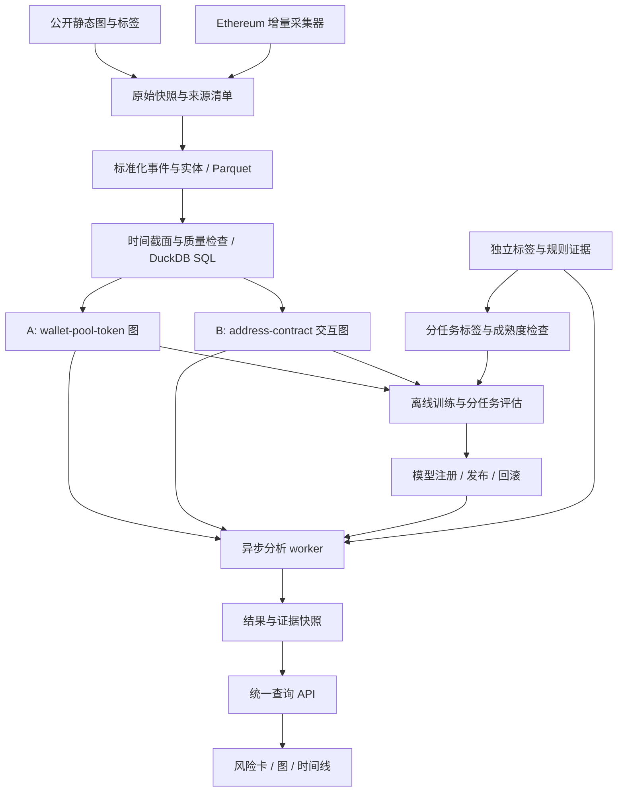

# Ethereum 链上行为与风险分析系统：需求、可行性与架构更新

版本：system-scope-0.2；决策日期：2026-10-05。

状态：**已采纳的项目目标与设计合同更新；新增诈骗模型、在线服务与联合训练尚未实现。** 本文基于当前仓库代码、已有实验报告、工作区 research、TrxLLM 文档和官方技术资料。历史报告中的指标是报告证据，本次没有重新训练或重算。

工程细化见 [平台工程方案与自采数据指导](PLATFORM_ENGINEERING_AND_DATA_GUIDE.zh-CN.md)：统一前端调用 Token 与 Scam 两个独立业务后端，共用图协议和 GraphSAGE 框架，分别保留数据分析与性能结果。从原 Canvas 的范围看，Scam 是原有下游任务，代币分析是新增任务；从当前仓库实现看，token 已有代码，Scam 仍需补齐。下文“新增诈骗任务合同”指相对当前代码仓库的合同扩展，不是改写 Canvas 的任务来源。

## 1. 决策与五个问题的直接回答

项目统一为 **Ethereum 链上行为与风险分析系统**，包含“新代币后续低活跃性预测”与“经典诈骗模式识别”两个任务族。统一之处是实体、事件、时间截面、图构建基础设施、GraphSAGE 实验框架、证据与服务接口；任务标签和输出含义保持独立。

| 问题 | 决策 | 必须保留的边界 |
|---|---|---|
| 保留 Ponzi、钓鱼、Honeypot，继续用图方案？ | 可以，均保留在需求中；按数据验收逐项交付，优先完成钓鱼，再做 Ponzi | 三者不是互斥类别；Honeypot 的卖出限制不能仅凭交易图可靠证明，需要规则、历史状态或模拟证据 |
| TrxLLM 图建模能用于 GraphSAGE？ | 目标中心、有限邻域、带属性的账户交互图可以借鉴 | BPE、带边属性的 GIN、Transformer、掩码预训练不是现有 GraphSAGE 的同义替换；需要独立适配和消融 |
| 开放静态数据 + 实时采集可行？ | 可行，是推荐的数据路径 | 未标注实时数据不能直接当正常样本；历史诈骗标签不能贴到任意当前时间窗；新代币完整标签约在 t0 后 97 天才成熟 |
| 能整合部署？ | 能部署为统一查询、监测、证据展示与筛查系统 | 当前尚无经核验的生产服务；“持续采集”不等于即时预知诈骗、实时训练或交易前阻断 |
| 两部分都用 GraphSAGE，如何保持一致？ | 首期共享代码、图接口、评估与服务；分别训练模型 | 同一模型架构不意味着同一图语义、相同权重或统一风险概率。共享编码器是后续可证伪实验，不是项目成立的前提 |

最适合的研究主线是：**在统一的、可追溯的时间截面图框架下，研究邻域行为信息对不同链上筛查任务的增量价值。** 活跃性是未来结果预测；诈骗分支首期是截至某一时刻的模式识别。只有获得诈骗发生时间和严格提前量标签后，才能将后者称为“诈骗提前预测”。

## 2. 证据范围与当前项目实际成熟度

此次同时参考了另一 Chat Session「解析 ds-crypto-project 结构与路线」，并以仓库实际文件核对。会话说明不替代代码、数据清单和运行结果。

| 资产 | 已有证据 | 能支持的结论 | 不能支持的结论 |
|---|---|---|---|
| 当前 token 研究合同 | [GOAL](../GOAL.md)、[CONTRACT](../CONTRACT.md)、[采样合同](COHORT_SAMPLING_AND_CLASS_BALANCE.md) | 第一周行为预测后续 90 天低交易量 | 预测价格、识别诈骗、证明项目永久死亡 |
| 数据工程 | [工作流](DATA_ENGINEERING_WORKFLOW.md)、`scripts/build_data_product.py`、`sql/model_tables.sql` | raw → Parquet → DuckDB/SQL → 特征/标签/图的批处理基础 | 已有生产流处理、完整线上数据覆盖 |
| 钱包图 | [输入合同](GRAPH_WALLET_INPUT_CONTRACT.md)、`scripts/build_wallet_graph.py` | 一 token 一图，wallet—pool—token；保留参与者角色与边特征 | 钱包等于真人；构图保存的字段都被模型使用 |
| GraphSAGE | [训练代码](../scripts/train_graphsage.py) | 原生 PyTorch 两层 mean aggregation、中心节点读出、互不连通的小图批处理 | PyG 异构模型、时间 GNN、已利用交易边文本或 edge features |
| 2026-10-03 报告 | [钱包图实验报告](../reports/model_comparison_wallet_graph_general_stratified_20261003_v1.md) | 报告了 2,000 token、988,383 标准化事件、三个随机种子 | 本地已经复现；结果可直接推广至自然全链分布或诈骗识别 |
| 旧 Canvas research | [可行性分析](../../research/Canvas-Feasibility-Analysis.zh-CN.md)、[数据审计](../../research/Data-Source-Audit.zh-CN.md) | 有开放数据路线及具体质量问题 | 所有大图已下载验收、许可已解决、实时接口今天仍保持旧配额 |
| TrxLLM | [文档评审](TRXLLM_REFERENCE_REVIEW.zh-CN.md) | 可参考的图构建与系统交互思路 | 已提供闭源训练数据、后端、checkpoint 或可复现完整方法 |

当前 checkout 中没有报告引用的完整训练数据与模型工件；部分合同引用的 `config/label_specification.json`、`config/event_schema.json`、`config/market_context_schema.json` 也未在本地提供。它们是应补齐的版本化合同，不应伪称已验收；本次不虚构配置内容或重建实验。`config/model_split.json` 保持原样。

### 2.1 已有性能应怎样解释

2026-10-03 报告的测试集为 209 个 token，99 个 continued_activity、110 个 low_volume_dead：

| 指标 | Wallet GraphSAGE 主种子 | 同 cohort 的 Logistic Regression |
|---|---:|---:|
| ROC-AUC，active 为正类 | 0.9478 | 0.9348 |
| AP，active 为正类 | 0.9344 | 0.9327 |
| 原生阈值下 dead recall | 0.8636 | 0.9182 |
| 原生阈值下 dead precision | 0.8796 | 0.8347 |
| dead 被误判 active 的比例 | 0.1364 | 0.0818 |

这说明模型管线具有实现基础，但 **AP 只差 0.0017，不能据此断言图模型显著优越**。阈值对应不同的误报/漏报取舍；三个种子仍使用同一个测试集，不是三个独立外部验证。旧 1,042 样本测试集的 AP 不能与此次直接横比。

报告采用 1,000/1,000 的冻结 pilot cohort；当前治理合同要求所有合格已标注样本、保留抽样概率和分组约束。必须核实该 pilot 的候选框与抽样过程，不能把平衡样本的比例解释成市场发生率。下一轮研究需保留历史结果，同时用符合当前合同的新 cohort 验证。由于此测试结果已经公开用于决策，后续反复调模型需要新的最终 holdout。

## 3. 更新后的任务定义

### 3.1 A：新代币后续低活跃性预测——保留现有研究合同

- 单位：Ethereum token contract，在预先冻结的 selected DEX/pool 范围内。
- `t0`：最早 selected-pool 创建时间；无法获得时才使用文档规定的首次 selected-DEX 活动回退。
- 特征：`[t0, t0 + 7 days]`，沿用当前包含边界的规则。
- 结果：cutoff 之后完整 90 天的 selected-pool 历史 `Swap.amountUSD` 总量。严格小于 USD 1,000 为 `low_volume_dead`，否则为 `continued_activity`。
- 仅 Swap 计入成交量；Mint/Burn 可作流动性特征。普通 transfer、空投、价格涨跌均不计入该标签。
- 随访、抓取、pool scope 不完整，或随访 Swap 缺少可用的正历史 USD 金额，则 `censored`，不能补成正常或异常。
- 保持主研究 split：标签与 launch-period 分层、overlap group 不拆分的 80/10/10。时间切分仍是次级压力测试；线上推广另外增加前瞻验证门槛。

`low_volume_dead` 只是历史沿用的标签名。界面应显示“后续 90 天低交易量风险”，不能显示“诈骗概率”“必然归零”或“长期一定不活跃”。90 天只是一个可测量的中期结果，不能概括全部长期生命力；以后若研究 180/365 天，必须新建标签版本并等待对应随访。

### 3.2 B：经典诈骗模式识别——新增独立任务合同

详见 [SCAM_TASK_CONTRACT.md](SCAM_TASK_CONTRACT.md)。首期按目标实体分别建二元任务，允许同一实体关联多个有证据的标签；缺少某任务标签时使用 mask，不把 unknown 填成 0。

| 分支 | 预测对象/标签 | 图中可能有用的信息 | 主要限制 | 首期形式 |
|---|---|---|---|---|
| Phishing | 地址；明确参与诈骗的角色与证据 | 入出账集中、资金归集、时序突发、对手方重复与邻域结构 | 受害者、交易所、路由器可能与恶意方交互；未知地址不是已证实 benign | 地址 egograph + 图/表格对照 |
| Ponzi | 合约；明确的 Ponzi 机制标签 | 入金与返款、重复支付、参与者分层、资金集中 | 仅拓扑相似不能证明新钱付旧钱；旧标签通常需要补交易与历史状态 | 合约 egograph + 特征基线；代码规则作独立证据 |
| Honeypot | token；卖出限制/陷阱的明确子类型 | 买卖不对称、成功/失败尝试、流动性、控制者关系 | 没有卖单可由无人卖出造成；一笔失败可由 allowance、余额、滑点或路由失败造成 | 图候选筛查 + 卖出限制规则/模拟核验；GraphSAGE 结果与核验证据分别显示 |

“经典智能合约诱捕陷阱”与“ERC20 买入后受限卖出”应使用不同 subtype。不要把安全防御意义的 honeypot 或任意冷门 token 混入训练。既然用户要求保留三类，就都保留在设计与验收清单；某分支数据不足时明确显示未就绪，并交付受限案例研究，不用其他标签冒充完成。

### 3.3 两类风险的关系

| 后续活跃性 | 诈骗证据/模式 | 合理解释 |
|---|---|---|
| 低活跃风险高 | 没有充分诈骗证据 | 冷启动失败、需求不足、市场变化等均可能；不能推断诈骗 |
| 活跃可能性高 | 诈骗证据强或模式分高 | 有持续交易也可能存在恶意控制或操纵 |
| 低活跃风险高 | 诈骗证据强或模式分高 | 两个维度同时值得审查，仍需核对各自证据 |
| 任意 | 数据缺失或任务不适用 | 显示 unknown/unsupported，而不是“安全” |

因此产品是一个风险信息系统，而不是把所有输出相加得到一个“通用安全分”。如需要排序，可设置可解释的审查优先级政策；该优先级不是概率，也不是新的未经验证的监督标签。

## 4. 需求与验收

| 编号 | 需求 | 可检查的验收条件 |
|---|---|---|
| FR-01 | 地址/token 统一入口 | chain_id、规范化地址、实体角色、as_of；不支持的链和任务有明确状态 |
| FR-02 | 活跃性预测 | 严格 7 天特征；未满 7 天返回 insufficient_history；输出 90 天结果含义和模型版本 |
| FR-03 | 三类诈骗分支 | 分任务数据卡、标签依据、适用实体、独立模型/规则版本；未就绪任务不伪造分数 |
| FR-04 | 历史与增量数据接入 | raw snapshot、去重键、分页完成状态、block hash、缺失/重组处理可追溯 |
| FR-05 | 证据图 | 明示边类型、方向、时间、来源、抽样/截断；可从聚合边追溯事件 |
| FR-06 | 训练与推理分离 | 无标签样本可以构图和推理；训练只消费成熟且通过质量门的标签 |
| FR-07 | 统一风险卡 | 独立的活跃性预测、诈骗模式分、规则观察、来源事实和覆盖信息 |
| FR-08 | 持续监测 | 游标持久化、失败重试、去重、数据滞后监控；变化触发重新物化而不是自动改标签 |
| FR-09 | 模型发布与回滚 | 输入 schema、图版本、归一化、权重、阈值、校准器匹配；能回滚整套版本 |
| FR-10 | 独立后端与结果归档 | Token/Scam 可独立调用和版本化；统一前端访问；每任务数据卡、EDA、模型比较和预测工件独立存档 |
| NFR-01 | 可复现性 | 同一 snapshot/config/seed 可重建派生数据；报告绑定版本与 checksum |
| NFR-02 | 时间正确性 | event time、证据可得时间、抓取时间分别存储；无 post-cutoff 特征 |
| NFR-03 | 不确定性 | 缺失不默认为 0；censored、unlabeled、conflict、unsupported 分开 |
| NFR-04 | 性能与成本 | 分别测缓存查询、冷抓取、构图、推理 p50/p95；队列/节点/边/API 预算有限且可配置 |
| NFR-05 | 服务边界 | 只读分析；凭证仅服务器持有；用户输入校验、请求限流、失败状态和日志可检查 |

首期不把多链、任意交易恶意分类、函数名恢复、自动买卖、通用大模型预训练纳入必交范围。Ethereum 外的链需要独立数据与标签验收，不因地址格式类似就自动兼容。

## 5. 统一数据设计：共享事实，分别形成任务视图

### 5.1 建议的实体与表

沿用 [现有数据工程工作流](DATA_ENGINEERING_WORKFLOW.md)，扩展为以下逻辑表；这是一份设计，不代表这些表均已存在。

| 表/工件 | 核心字段与责任 |
|---|---|
| `entities` | `(chain_id, address)` 物理身份；token/pool/contract/participant 是可并存且有时间范围的角色 |
| `events` | block_number/hash、tx_hash、log_index 或 trace_path、event_type、src/dst、asset、原始 amount、decimals、status、event_time、source、retrieved_at |
| `event_roles` | sender/recipient/transaction_origin/deployer 等显式角色；不互相静默回填 |
| `state_snapshots` | 指定 block 的 balance/nonce/code 等；当前状态不能冒充历史状态 |
| `source_evidence` | 标签/规则来源、证据链接或摘要、valid_from/to、known_at、观察区块、可信级别、许可 |
| `task_samples` | task_id、entity_id、cutoff、window、graph_view_version、quality、sample_id |
| `task_labels` | sample_id、task_id、value、label_status、label_available_at、onset_time、label_version、source/conflict |
| `split_manifest` | 每任务样本与 entity/campaign/group 的 partition；跨任务共同 holdout 审计 |
| `graph_artifacts` | 节点/边特征、root 索引、类型与方向、时间边界、抽样参数、事件 lineage |
| `model_registry` | 模型及输入合同、scaler、阈值/校准器、训练数据/时间、指标、代码版本、适用范围 |
| `assessments` | 各任务结果、status、cutoff、模型版本、证据/覆盖、生成时间；不覆盖历史输出 |

Swap 日志、ERC20 Transfer 日志、外部交易、内部调用是不同事件，不能相互替代。一笔 Swap 可以对应多条 Transfer；统一数据层须避免重复计量。trace 与 logs 使用各自唯一键，不能仅按 tx_hash 去重整笔交易。ETH、wei、token raw amount、历史 USD 分列保存；不得把不同资产原始金额直接相加。

链上确认与查询可得时间也不同：历史不可变事件可以在今天抓取并重建过去截面，但必须证明该信息在当时已存在。外部风险标签、ABI 解析、价格修订等需另外记录 known_at；不能以今天的第三方风险标记回填过去特征。对无法证明历史可得性的字段，标记不可用于提前预测，或在严格回测中排除。

### 5.2 三条数据路径

| 路径 | 合理用途 | 禁止的捷径 |
|---|---|---|
| 公开静态图与已标注数据 | 监督学习 pilot、算法比较、历史案例 | 不审字段就合并；未标注邻居当 benign；全历史图直接宣称提前预测 |
| 公开标签 + 按历史区块补链上数据 | 对齐实体/时间的 egograph，构建可追溯训练集 | 给旧 Ponzi 合约抓今天 30 天的空图并沿用旧标签 |
| 自采增量事件 | 线上推理、覆盖/漂移分析、之后成熟的监督样本；受控的无监督实验 | 把未报警地址自动标正常；把模型自己的高分直接作为真实诈骗标签 |

实时流是持续追加的事实库。训练采用冻结快照与版本化标签，经过离线评估再发布。诈骗真值需要有独立证据的人工/可信来源复核；自监督学习也必须遵守实验的时间和 holdout 边界。

新代币的特征在第 7 天可齐备，监督标签要等随后 90 天完成，即约第 97 天，另加索引/核验延迟。五周内可交付历史训练与前瞻推理演示，不能声称已验证五周内新发行 token 的完整 90 天结果。

### 5.3 开放数据来源与选择

以下历史计数来自 **2026-09-21 已保存的本地审计**，不是本次重新下载全量数据的结果。详细证据、SHA256、实际已读文件与未读内容见 [Data-Source-Audit](../../research/Data-Source-Audit.zh-CN.md)。

| 数据源 | 已知资源 | 推荐用途 | 进入训练前的门槛 |
|---|---|---|---|
| XBlock phishing id=13/6/9 | id=13 官方描述约 297 万节点、1,355 万边、1,165 标注；id=6 的 negative 明确是 unlabeled；版本不可混写 | 首个诈骗图实验优先候选；按资源选一个版本 | 实际文件加载、字段/金额/时间/负类语义、seed-neighborhood 抽样偏差、许可核验 |
| XBlock Smart Ponzi id=22 | 3,793 行；200 正、3,590 零、3 error；标签 CSV 无交易图 | Ponzi 历史标签起点 | 排除 error，补齐历史 external/internal 交互，审核零标签与时间范围 |
| blockchain-unica/ethereum-ponzi | 182 唯一地址、源码与采集脚本；并非自带完整交易表 | Ponzi 补充与案例核对 | 与 XBlock 交集存在 2 个标签冲突，必须隔离；代码/数据许可分别记录 |
| TokenScout 公开处理数据 | 214,084 token 标签；其中 22,800 honeypot、9,483 ponzi（原数据分类） | 后续 token scam 图分类对照 | 整数 ID、变换金额/时间需解释；不能自动等同当前 selected-pool 任务；未验明还原和许可前不进线上主模型 |
| Forta labelled-datasets | 官方仓库提供 Ethereum phishing/恶意合约等 CSV 及来源字段 | 额外种子与证据交叉检查 | `involved` 不自动等于攻击者；标签不是独立人工真值，也非完整邻域；逐行审核角色、时间、重复来源 |
| 自采 Ethereum 日志/交易/状态 | 可以控制窗口、范围、质量与增量过程 | 统一系统长期数据主干 | provider 覆盖/分页/限流/历史查询成本需实测；必须保存来源和失败记录 |

新核验入口：[Forta 官方仓库](https://github.com/forta-network/labelled-datasets)。XBlock/Unica/TokenScout 的精确官方链接与限制保留在上述旧审计，避免把历史可达性说成持续保证。

默认先选择**一个** phishing 版本，不同时下载/融合多个大图。Ponzi 先验证几十个正负实体的历史采集能成功，再扩大。Honeypot 先冻结语义与证据流程，再决定 TokenScout 子集或自建核验案例。数据/模型可公开分发的权利与内部研究可读取的权利分别登记；不因为仓库公开就假设所有上游数据可再分发。

## 6. GraphSAGE 的复用范围与方法选择

### 6.1 统一的是图框架，不强迫统一成一张图

| 层 | 共用内容 | 保持独立的内容 |
|---|---|---|
| 采集/存储 | 事件 envelope、地址标准化、去重、时间/来源审计、Parquet | DEX、transfer、trace 等专用 adapter |
| 构图 | cutoff 过滤、邻域预算、采样记录、root/lineage、质量状态 | token wallet-pool 图、地址转账/调用图、Honeypot 证据图 |
| 特征 | 计数、时间间隔、集中度等函数库，显式 missingness | 数值单位、节点类型、资产语义、观察窗和参数 |
| 模型 | PyTorch MeanSAGE、批处理、训练/推理接口、任务 head 抽象 | 首期各自的权重、scaler、阈值、校准器 |
| 评估 | 分组切分工具、PR/ROC、置信区间、错误分析 | 标签极性、基率、审查预算、接受阈值 |
| 产品 | entity 查询、任务状态、图证据、版本与历史结果 | 每个任务的得分含义、资格判断和解释 |

活动图的 pool membership 是结构关系，诈骗图的 transfer 是资产流关系；不能把两种边都解释为资金转移。物理地址可有多种角色，但当前 token 图中的角色节点身份继续遵守 v0.1 builder；跨视图统一使用物理 entity_id 映射，不在旧模型中悄悄合并节点。

[GraphSAGE 原作者说明](https://snap.stanford.edu/graphsage/)支持对未见节点/图作归纳式表示，但要求属性 schema 与训练兼容。它不保证跨任务、跨链、跨经济时期泛化。

### 6.2 对现有代码的具体适配

当前 `train_graphsage.py` 的 `graph_tensor()` 读取 `node_features` 和 `edge_index`，且要求 `label` 属于固定二元枚举。模型虽可处理多个独立图，**在线未标注请求仍不能直接复用当前评分入口**。需拆成无标签 tensor 构造、监督标签 collator 和纯推理函数；保留旧训练接口兼容性。

当前两层 mean aggregation 可表示为：

`h_v^(k+1) = ReLU(W_self h_v^k + W_neighbor mean({h_u^k: u∈N(v)}))`

读取 root embedding 得到实体分数。两跳刚好覆盖 wallet—pool—token 路径；更深的账户追踪图要验证 root 的有效感受范围，不能以抓取更多跳数等同于模型利用了更多跳数。邻居预算也可能丢失小额关键边，需记录覆盖与稳定性。

| 方案 | 实现与收益 | 代价/决策 |
|---|---|---|
| M0：现有 MeanSAGE + 节点聚合统计 | 最快复用；将部分金额/时间统计汇入节点 | 不能完整表达边级方向和关系；作为首期基线 |
| M1：关系/方向感知的 SAGE 变体 | 按 incoming/outgoing、transfer/call/membership 等分别聚合；显式编码金额/时间 | 是新输入/模型版本，要从头训练或明确迁移；先与 M0 对照 |
| M2：交易/事件节点图 | 以事件节点携带字段，可保留多重交互 | 图规模和 hop 语义变化；不属于 wallet-graph-input-0.1，首期不做 |
| M3：BPE + GIN/Transformer 等 | 更接近 TrxLLM 文档 | 闭源数据、训练资源、文本化信息损失与复现工作较大；不作为项目主线 |

即使 M0 保存了 relation/edge_features，报告也必须列出 **模型实际消费字段**。未来如做交易级 head，用有方向的 `concat(h_src, h_dst, event_features)`；不照搬相加后无法区分方向/平行交易的表示。

### 6.3 共享权重的后续研究

第一阶段：独立训练各任务，建立可复现基线。第二阶段：在训练边界内共用自监督预训练，再分别微调。第三阶段：仅在语义对齐、数据足量时，比较共享编码器 + 多任务 head。

多任务损失使用 `Σ_t α_t × mean(loss_t on labeled samples of task t)`，任务缺失标签 masked out，控制不同数据量的采样比例。各任务可以有自己的输入 adapter/readout；不能仅把特征 padding 到相同维数就称其语义一致。

共享训练必须执行跨任务泄漏审计：某个 token 若是 A 的测试对象，不能因为它在 B 中有标签就用于共同编码器监督训练；相关合约/campaign 和未来事件也须检查。共享预训练的事件、实体与时间范围都要入 manifest。保守首期排除所有 held-out 目标实体及已识别同组实体，说明允许的常见邻居重叠；路由器/交易所等高连接节点不能无差别把全链合成一个分组。

只有相对于“各任务独立模型”在预先定义的性能/校准/成本容忍范围内不发生不可接受退化，才发布共享权重。若发生负迁移，保留独立权重仍是完整、统一的系统，而不是项目失败。

## 7. 评估设计：让任务一致地可验证

1. **每个任务都有非图基线。** 相同 cohort/split/cutoff 上比较规则、LR/GB、仅自身特征 MLP、GraphSAGE；控制特征信息量，增加邻域统计表格基线。否则“图赢了”可能只因图获得更多信息。
2. **图作用消融。** 无邻域/打乱结构（仅在实验允许的训练与评估样本内部进行）、不同 hop、方向/关系、去除第三方标签特征；不以可视化聚类替代性能证据。
3. **标签和极性清楚。** A 当前 trainer 正类为 active；面向风险应另算 dead 为正类的 AP/PR，不能把 active AP 改名成 dead AP。B 正类为该特定诈骗模式。
4. **按任务报告。** PR-AUC/AP、ROC-AUC、precision/recall、macro-F1、FPR、Precision@K、支持数、自然或抽样基率、分组置信区间。PU 数据报告“已知正类 vs 未标注对照”，不能声称已验证 benign 上的真实 FPR。
5. **阈值和校准只用 train/validation。** Sigmoid 不自动成为校准概率；需要独立 calibration 评估（如 reliability/Brier）。自然发生率未知时优先称 model score，并显示适用数据范围。
6. **时间与分组。** A 保留现有主 split，增加后期 cohort/前瞻 shadow test 作为发布门槛。B 将同地址多快照、同攻击/campaign、重复或高度相似合约隔离；有时间信息时另外作前向测试。
7. **识别与预警分开。** 使用攻击发生后行为训练的模型只能称识别；提前预测另需 `cutoff < onset_time` 和固定提前量、独立标签版本。
8. **小样本约束。** 用独立实体或 campaign bootstrap，不能用百万条边当百万个独立标注样本。每类支持数与区间必须给出；100 个可信负例零误报也不足以证明实际 FPR 低于 1%。

选择发布模型时并不要求 GraphSAGE 必须战胜表格模型。若 LR 在审查预算/漏报约束下更适合，平台可以部署 LR，继续把 GraphSAGE 作为受控实验；研究价值在于公平比较及明确图信息什么时候有用。

## 8. 系统架构与部署路径



首期采用模块化单体加后台 worker：建议 Python API（如 FastAPI）、已有 Python 数据/模型代码、Parquet/DuckDB 分析层、轻量任务与结果数据库、Vue 展示层。具体依赖版本在实施时锁定。这不是必须上 Kafka、图数据库或多服务集群的场景；出现实际吞吐和并发瓶颈再增加组件。

这里的 worker 是公共处理流程的概括。业务上明确分为 Token 分析后端和 Scam 分析后端，具有独立接口、模型包和结果；平台入口负责路由与状态聚合。首期可以同仓库/同部署中的独立模块运行，也可以分进程/容器部署，按依赖与负载决定。一类分析失败不影响另一类成功结果。共同图容器不强制共用同一拓扑、特征含义或模型权重；具体接口及归档协议见 [工程细化](PLATFORM_ENGINEERING_AND_DATA_GUIDE.zh-CN.md)。

DuckDB 用于批处理分析与生成快照；在线多个 worker 不共同写同一分析库。演示可用单 writer 作业/结果存储；多进程上线时用具备相应并发能力的数据库和队列。GPU 训练与请求处理分开，CPU 推理是否足够以节点/边规模和 p95 实测决定；报告使用 GH200 120GB 不等于系统必需该硬件。

### 8.1 在线处理顺序

1. 校验 chain/address/task/as_of，解析实体角色，查缓存与模型适用范围。
2. 已有完整快照则直接评分；缺数据时创建异步作业，返回 job id 与 pending，不能展示默认低风险分。
3. 采集 finalized 或按明示确认策略接受的区块，记录 hash；处理 reorg 时撤销受影响派生事件/结果再物化。
4. 以任务固定窗口构图，通过质量门后评分。A 第 7 天的历史窗口冻结；之后更新数据状态与成熟结果，不能把累计 30 天图喂给 7 天模型。新增滚动预测需单独模型版本。
5. 结果存储包含 feature cutoff、data as_of、generated_at，页面明确区分三者；显示模型输出与独立观察证据。
6. 新标签成熟后进入下一次离线训练候选集，人工/自动质量门和评估通过后才发布。

建议接口：`POST /analyses` 创建或复用作业；`GET /analyses/{id}` 取结果；`GET /entities/{chain_id}/{address}/history` 查历史。请求显式包含 task_ids、as_of。推理请求**不要求 label**。

统一结果的逻辑示例（字段设计，不是已实现 API）：

```json
{
  "entity": {"chain_id": 1, "address": "<validated-address>", "roles": ["token"]},
  "feature_cutoff": "<UTC>",
  "data_as_of": "<UTC>",
  "tasks": {
    "activity_7d_90d": {"status": "ready", "score_low_volume": 0.72, "score_kind": "uncalibrated_model_score", "model_version": "<id>"},
    "phishing_address": {"status": "unsupported_entity", "score": null},
    "ponzi_contract": {"status": "model_unavailable", "score": null},
    "honeypot_sell_restriction": {"status": "insufficient_evidence", "score": null}
  },
  "observed_evidence": [],
  "coverage": {"complete": true, "scope": "<selected pools and window>"},
  "graph_version": "<id>"
}
```

示例数值是展示接口的占位值，不是任何真实 token 的评估。`ready` 只表示该任务可返回结果，不代表安全；`coverage.complete` 只针对声明的数据范围。pending、insufficient_history、data_incomplete、stale、out_of_domain、model_unavailable 应有独立显示。训练标签的 censored/pending_label 不应阻止输入完整但结果尚未成熟的正常在线推理。

### 8.2 前端复用判断

现有 [TrxLLM 前端](../../TrxLLM/TrxLLM-Vue/src/views/TradeIdentification.vue)主要根据两个固定交易哈希跳转示例结果；[实时页](../../TrxLLM/TrxLLM-Vue/src/views/RealTimeData.vue)通过定时器跳转 Explorer。它提供布局与交互参考，不能当成已接入实时采集或模型服务的证据。

可保留地址输入、图展示、分标签卡片的交互方向。需重新接真实 API、取消无依据的多链/全能安全文案、加入状态和数据时间、分离活动与诈骗标签。复用源码/素材前记录授权与署名要求，不假设其他项目交付即允许任意公开再分发。

## 9. 工作分解、实施依赖与资源

| 阶段 | 工作与现有入口 | 完成门槛 | 未过门槛时 |
|---|---|---|---|
| P0：证据与合同固化 | 当前文档更新；核对缺失配置、报告工件；数据源小样本验收 | Task A 原规则可追溯；一个诈骗版本可加载；目标/标签/时间无歧义 | 先补工件或限缩数据范围 |
| P1：共同数据和图接口 | 复用 `build_data_product.py`、`participant_fields.py`、`build_wallet_graph.py`；新增 scam adapter、label registry、quality manifest | 两任务都可由冻结 raw 重建；无未来信息；负类/unknown 分开 | 仅历史描述分析，不能宣称上线可泛化 |
| P2：独立模型闭环 | 抽取 `train_graphsage.py` 的通用部分；复用 tabular/calibration 工具；实现无标签推理 | A 与 phishing 各有 matched baseline、独立 holdout 和错误分析 | 保留可用表格基线；记录 GNN 负结果 |
| P3：另外两类诈骗 | Ponzi 补历史交易；Honeypot 语义/证据/图对照 | 各自有数据卡、样本支持、核验证据和明确输出边界 | 保留案例/规则模式，不伪装成已训练分类器 |
| P4：统一演示与有限上线 | API/worker/registry/结果库 + Vue；增量采集与 shadow mode | 一次真实未标注请求端到端完成；过载/缺失/reorg/回滚有演练 | 仅离线演示并标注 snapshot 日期 |
| P5：研究扩展 | 关系感知 SAGE、训练期预训练、多任务对照 | 每任务增益/退化与成本有证据；共同泄漏审计通过 | 发布独立模型，继续共用平台 |

这是依赖顺序，不是必须串行完成所有工作。粗略规划估计：P0 约 2–4 人日，P1–P2 约 2–4 人周，P3 约 2–4 人周，P4 约 1–3 人周；P5 另行预算。区间是基于当前缺口的工程估算，不是测得工期；数据许可、历史 trace 可得性和标签复核可能成为主要等待项。

若沿用五周课程约束，建议核心承诺为“已存在的活动预测 + 一个严格的诈骗图实验 + 统一离线/异步演示”，Ponzi/Honeypot 逐项按数据门槛交付。**三类都训练成熟、自然分布验证、持续生产运维和多任务预训练不能在没有额外资源证据时同时保证。** 这不删除三类需求，而是区分目标范围与首批可验收范围。

采集成本按 `实体数 × 窗口事件量 × 分页/trace请求成本` 估计；预先设置请求/天、邻居/目标、最大边数、重试与存储预算。图内存约随采样后节点数、边数、维度和 batch 增长，记录实际峰值再调 batch。暂不承诺固定 API 费用或秒级冷启动 SLA；分别测缓存命中、冷抓取、构图与推理，才知道优化重点。

## 10. 关键风险与应对

| 风险 | 影响 | 应对与停止条件 |
|---|---|---|
| 开放数据只有标签，没有交易或时间 | 图模型无法复现或无法作前瞻评估 | 实际补数 pilot；时间无法解锁时只做静态识别 |
| 未标注被当负类、不同来源冲突 | 虚假准确率和校准 | 标签状态/来源隔离；PU 或明确受限的 case-control 评价 |
| 训练图与测试图共享近重复对象 | 记忆关系替代泛化 | 按 entity/campaign/相似合约分组，报告残余重叠 |
| 使用 GoPlus 等最终判定作特征和标签 | 标签捷径与时间泄漏 | 第三方标签默认作外部证据；若实验纳入则时间对齐并单独消融 |
| 路由器被误认为大量“共同用户” | 图结构解释错误 | 保留 sender/recipient/origin 角色；路由器集中度敏感性分析 |
| 早期图只能看到成功交易 | Honeypot 失败尝试缺失 | 补 receipt/trace/模拟条件；不能用缺失卖单当确定限制 |
| 旧 scam 训练集与现代 DEX 差异 | 分布外低可靠性 | 限定年代/协议范围；外部数据与前瞻 shadow gate |
| 不同模型分数直接融合 | 生成无意义的“总概率” | 多维风险卡；融合模型需独立共同标签和联合验证 |
| 上线后标签长期不成熟 | 无法立即证明效果 | 先历史回放与质量监控，等待成熟 cohort 再做结果评价 |

最终交付物应包括：每任务数据卡与模型卡、版本化事件/标签/图合同、可复现数据/训练命令、matched 评估表、误报案例、API 与界面、部署/回滚说明。**“系统上线成功”与“模型证实有预测价值”是两项独立验收，都需要证据。**

## 11. 本次治理变更与不变项

- 总目标从单一 token 低活跃性研究扩展为统一行为与风险分析系统；新增诈骗任务合同和服务设计。
- `GOAL.md`、`CONTRACT.md`、`PLAN.md` 已同步项目范围；原 token 数值标签、窗口、主 split、报告不改写。
- 原 Canvas/research 作为历史来源保留。涉及新仓库和 TrxLLM 的路线选择，以本文与当前任务合同为准；旧审计中的可验证数据问题仍有效，来源可达性须实施时再核验。
- 本次只更新分析与文档，不声称已经补齐数据、重训模型、复现 TrxLLM、实现 API 或部署上线。
