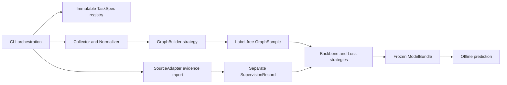

# Task B implementation and usage guide

当前公共阶段以 [统一入口说明](SCAM_PIPELINE.md) 为准：`sources / collect / prepare / train / all / status`。`all` 包含训练并要求 `--run`；本文较早的内部阶段与历史实验记录不改变既有结果。

Date: 2026-10-15. Release status: code and synthetic engineering checks only.
A real Phishing address-only cohort is frozen; complete training data, formal
training runs, research metrics and model weights remain pending. See the
[unattended pipeline and storage guide](PHISHING_OFFLINE_PIPELINE.md).

## 1. Delivered scope

The 2026-10-20 Ponzi revision adds unattended source/cohort/collection/prepare
stages to `scripts/scam/run_pipeline.py --task ponzi`. Its frozen XBlock/Unica
cohort contains 247 conflict-free positives and 1,000 deterministic XBlock
negatives with source-specific historical anchors and bounded descending
graphs. Training is explicit and uses independent weights. See
[the Ponzi offline pipeline](PONZI_OFFLINE_PIPELINE.md) for the run order,
source-defined label admission, recovery and limitations.

Phishing/Ponzi provide source import, ETH collection, normalization, evidence and
label governance, directed local graphs, independent training/evaluation, model
bundles and offline prediction. Honeypot/Rug Pull now provide selected-pool verification, evidence capture/import,
ERC20/v2 collection, versioned mechanism features, dataset preparation and the
same complete offline training/evaluation/bundle/prediction lifecycle. See the
[token training guide](TOKEN_SCAM_TRAINING_PIPELINE.md). Rug Pull is limited to malicious Ethereum Uniswap v2 liquidity
withdrawal.

The four tasks are independent and may overlap; they are not mutually exclusive
classes. A future transaction entrypoint first resolves related entities, obtains
their histories and evaluates each entity separately. This release adds no
transaction-level labels or weights. Models return scores and threshold-based
classes. Uncalibrated scores are not scam probabilities; missing models or
incomplete data produce null scores and explicit statuses.

Task A entrypoints, historical reports, `apps/` and `deploy/` are unchanged. As
requested, Task B uses the existing uv project, arm64 Python 3.11 `.venv` and root
`uv.lock`; no separate training environment is created.

## 2. Structure and design patterns



- `packages/`: task protocols, source governance, collection, event
  parsing, graph/tensor conversion, models and model bundles.
- `research/scam/`: configurations, frozen splits, shared training/evaluation,
  tabular baselines and CLI.
- `checks/`: synthetic fixtures, semantic, numerical and CLI integration checks.

Registries define explicit extension points. CLI handlers do not define labels or
models. Data, supervision and model state are separate, so inference never
requires a known label.

## 3. Graphs and supervision

New Phishing snapshots now use the bounded recent view described in
[PHISHING_OFFLINE_PIPELINE.md](PHISHING_OFFLINE_PIPELINE.md), including per-root
graph publication, scratch raw deletion and shared in-process concurrency. The
legacy address-graph defaults below remain applicable to older snapshots and
other address-task configurations.

Address graphs default to the 30 days preceding cutoff, two hops, fanouts 32/16,
at most 512 nodes and 4,096 aggregate edges. Original direction is preserved;
independent reverse message relations are created during tensor conversion.
Edges are grouped by endpoints, relation and asset. Node features distinguish
ETH from target-token amounts and retain missingness when units are unknown.

Collection and graph construction share deterministic neighbor selection. Root
and selected first-hop histories are collected; boundary statistics explicitly
describe the sampled observed subgraph. Intentional sampling truncation is
recorded separately from failed requests or time gaps. Etherscan indexed internal
transfers are not complete execution traces.

Token graphs add historically supported pool/token/deployer relationships.
ERC20 transfers connect tokens to participating wallets through `participates`,
avoiding an isolated token root. This relation implies neither ownership nor
maliciousness. A v2 pair can be both pool and LP-token contract; one address has
one identity with multiple roles. Mint, Burn, Sync, Swap and LP Transfer retain
their separate meanings. LP holdings remain unknown; raw integer net flows are
stored for the sampled window. Verified targets supply pool addresses. Explicit
factories can collect window-bounded PairCreated logs; all-chain pool discovery
and v3 position parsing are not implemented.

Imported public labels do not automatically become ground truth. Roles, time,
review decisions and cross-source conflicts must pass admission. Missing sells
do not prove Honeypot; withdrawals or inactivity do not prove Rug Pull. Phishing
defaults to a known-positive-versus-unlabeled benchmark with an explicitly frozen
background cohort; canonical `unlabeled` records remain unchanged. Ponzi
negatives apply only to the source's Ponzi definition.

## 4. Models and evaluation

The two-layer MeanSAGE baseline is paired with SAGE that aggregates by direction
and relation and consumes amount, relative time and missingness. The upgraded
model adds residuals, LayerNorm and Jumping Knowledge concatenation. Defaults
are hidden size 64 and dropout 0.2, with three-layer and direction/relation/edge
attribute ablations available.

Loss defaults to BCE weighted from training-set counts. Focal is optional
(`gamma=2`; `gamma=0` matches weighted BCE). nnPU, contrastive pretraining and
shared weights remain future work. TrxLLM's GIN + Transformer is not reused as
GraphSAGE training code.

Defaults are AdamW, learning rate 0.001, weight decay 0.0001, batch size 32, at
most 200 epochs and patience 25. Entity and evidence-backed group splits freeze
90/10 train/validation (2026-10-20 revision); insufficient class support stops execution. Scalers fit training data
only. Validation AP alone selects checkpoints and controls early stopping:
an improvement greater than `min_delta` saves the model and resets patience.
Stop when patience expires or the epoch limit is reached, then restore the saved
model. Training loss is reported; validation loss is not computed. Macro-F1
selects the classification threshold. Training overrides preserve
the frozen prepared dataset. See [the detailed selection rules](PONZI_OFFLINE_PIPELINE.md#validation-monitoring-and-model-selection).
Neighborhood overlap is reported; common routers do not define scam
campaigns. Bundles freeze graph recipes, feature order and relation semantics;
matching dimensions alone do not establish compatibility.
Final reports use validation Accuracy and retain Balanced Accuracy, F1, class
counts, raw confusion counts and row-normalized confusion matrices. Validation
also selects checkpoints/thresholds, so this is not an independent test estimate.

Tabular baselines use own-feature logistic regression and neighborhood/edge
summary gradient boosting on the same samples and split. Standard metrics use
scikit-learn and retain P/U benchmark semantics. None of these formal fits or
research evaluations has been run.

## 5. Running and acceptance

Complete commands are in the [Task B README](../research/scam/README.md). From
the project root:

```bash
uv sync --frozen --python 3.11
uv run --frozen python -m unittest discover -s checks -v
uv run --frozen chainrisk-scam --help
```

JSONL and Parquet are supported. Raw responses, coverage, normalization audits,
evidence, supervision and graphs are stored separately. Checks cover paging,
resume, interval splitting, failed/unknown execution, deduplication, units, time
boundaries, label conflicts, P/U masking, entity/group splits, explicit roots,
batch offsets, direction and edge attribute effects, loss, bundle roundtrips
and end-to-end CLI dry runs.

CPU is the default verification device. Explicit MPS requires
`torch.backends.mps.is_available()` and fails clearly otherwise. CPU checks do
not establish MPS performance.

On 2026-10-09, **74 checks passed** in the existing frozen uv environment:
Python 3.11.16, arm64 and PyTorch 2.14.1. The CLI entrypoint was verified. Model
version digests cover weights, scaler, threshold and graph recipe. Empty bundle
directories without weights also return `model_unavailable`.

Public papers and comparisons are stored in the outer
[researches directory](../../researches/Task-B-Method-Comparison.md). SHA256 was
verified for seven PDFs. The weighted-focal Phishing paper returned HTTP 403;
its formal link is retained in the [paper manifest](../../researches/task-b-paper-manifest.json).
Real data must pass evidence and temporal admission before formal training.
Engineering checks do not establish research model quality.

On 2026-10-15, **88 offline checks and 32 existing backend regression checks
passed**. Token checks validate both graph schemas, selected-emitter collection,
historical metadata verification, reviewed API/incident labels, temporal/pool
isolation, preparation, training dry-run, both SAGE backbones, and frozen bundle
evaluation/prediction. No real provider requests or formal training ran. Synthetic
untrained model bundles existed only in temporary test directories.
