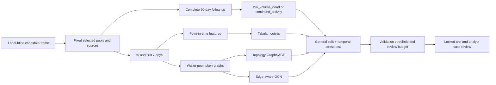

# Ethereum token project result analysis

Version: `wallet_graph_project_result_analysis_20261005_v1`  
Project revision observed during analysis: `aa7b2aa5523c63eda88286457aa3717d18f08a4d`

## Abstract

This report evaluates whether the first seven days of selected Ethereum DEX activity can rank token projects by their subsequent 90-day activity. The target is a volume-based outcome: `low_volume_dead` means less than USD 1,000 in selected-pool swap volume during the complete follow-up, while `continued_activity` means at least USD 1,000.

The study uses a matched cohort of 2,000 tokens and compares a tabular logistic baseline with topology-only GraphSAGE and an edge-aware GCN. On the general stratified test, the validation-selected edge GCN produced failure F1 0.886, failure recall 87.3%, and realized test FPR 10.8% at the 10% validation FPR budget. General-test `Precision@20` was 100% for all three model families (Edge GCN: 100.0%, Topology GraphSAGE: 100.0%, Tabular logistic: 100.0%).

The chronological holdout separates ranking quality from operating-point stability. Topology-only GraphSAGE ranked slightly better than edge GCN, while edge GCN had the higher failure F1 at the selected budget. Its realized test FPR was 20.0%. The results support an analyst workflow that ranks cases, allocates a review budget, and examines transaction and wallet-pool context. Graph structure improves on the compact tabular baseline in this experiment, while the value of edge features changes across splits.

## 1. Study question and use case

The study addresses early review of newly launched or obscure Ethereum token projects. A researcher or review operator needs a way to prioritize cases before the 90-day outcome is known. The model therefore uses information available by a fixed seven-day cutoff and ranks tokens by their estimated probability of the low-volume outcome.

The intended workflow is analyst-led. A ranked list determines which cases receive attention first; the reviewer can then inspect transactions, wallet-pool structure, and later outcomes. This keeps the prediction task connected to a concrete review process and makes false alerts and missed failures part of the evaluation.

## 2. Data and method

The prediction unit is one token contract. `t0` is the earliest selected-pool creation timestamp, with the documented activity fallback. Features use the inclusive seven-day interval from `t0` through the cutoff. The label uses the following complete 90 days. Swaps count toward volume; mints and burns remain feature channels but are not added to the volume outcome.

The tabular baseline uses nine raw pre-cutoff values: event count, swap count, mint count, burn count, pre-cutoff USD volume, missing swap-USD count, active-day count, pool count, and protocol count. The saved logistic baseline fits `StandardScaler` on training rows only and then fits logistic regression; it does not log-transform the values for model fitting. The EDA log1p views below are display transforms only.

The graph representation is one local graph per target token: wallet -> swap activity -> pool -> contains -> target token. Wallet nodes represent observed blockchain addresses. The graph includes wallet-pool relationship features such as swap count, positive historical USD volume, active-day fraction, time offsets, role counts, and missing-amount flags. Learned wallet state is not shared between token graphs or partitions.

The primary evaluation is the frozen general token-level split. The secondary temporal split assigns rows by `t0`: before 2024 to train, 2024 to validation, and 2025 onward through 2026-06-24 to test. Thresholds, architecture selection, and `K=20` review-budget selection use validation data only; test rows are scored after that checkpoint.

## 3. Cohort and exploratory analysis

The matched cohort contains 2,000 complete labels: 1,000 continued-activity and 1,000 low-volume-dead tokens. The general test prevalence is 52.6% low-volume dead (209 rows). The chronological test contains 185 rows: 145 low-volume dead and 40 continued activity (78.4% low-volume dead).

### Partition support

General stratified:

| Partition | Continued activity | Low-volume dead | Total |
| --- | ---: | ---: | ---: |
| train | 800 | 796 | 1596 |
| validation | 101 | 94 | 195 |
| test | 99 | 110 | 209 |

Chronological stress test:

| Partition | Continued activity | Low-volume dead | Total |
| --- | ---: | ---: | ---: |
| train | 720 | 618 | 1338 |
| validation | 240 | 237 | 477 |
| test | 40 | 145 | 185 |

The general split is close to balanced because the selected cohort was frozen at 1,000 rows per label. The temporal test has 78.4% low-volume-dead prevalence. That shift changes the interpretation of average precision, so the ranking results should be read alongside the partition counts.

### Nine-feature view

| Feature | Active median [IQR] | Low-volume median [IQR] | Zero share |
| --- | ---: | ---: | ---: |
| Event count | 396 [40.8, 1.1k] | 26 [8, 72] | 8.0% |
| Swap count | 396 [40.8, 1.1k] | 26 [8, 72] | 8.0% |
| Mint count | 0 [0, 0] | 0 [0, 0] | 100.0% |
| Burn count | 0 [0, 0] | 0 [0, 0] | 100.0% |
| Pre-cutoff volume | 171.6k [16.0k, 804.7k] | 2.9k [336.0, 20.0k] | 8.0% |
| Missing swap USD | 0 [0, 0] | 0 [0, 0] | 99.8% |
| Active days | 7 [4, 8] | 1 [1, 1] | 8.0% |
| Pool count | 1 [1, 1] | 1 [1, 1] | 0.0% |
| Protocol count | 1 [1, 1] | 1 [1, 1] | 8.0% |

The clearest separation is activity intensity: continued-activity tokens have higher median early volume, swap count, and active days. `event_count` and `swap_count` are identical for all 2,000 rows (`True`), so they form one redundant signal. Mint and burn counts are constant zero (`mint_count=True`, `burn_count=True`); their fitted coefficients are zero and they provide no variation in this cohort. Pool count is concentrated at one and contributes little variation. The tabular baseline therefore relies mainly on early activity intensity and active days.

All joined feature rows are complete (`0` rows with any missing value), and the frozen feature audit reports no pre-`t0`, post-cutoff, or missing-timestamp violations. The missing swap-USD count is zero for almost every row, so it records data quality while contributing little variation to prediction.

The largest non-constant redundancy pairs in a Spearman view are Event count with Swap count (1.00), Event count with Pre-cutoff volume (0.91), Swap count with Pre-cutoff volume (0.91), Event count with Active days (0.83). These correlations explain why the logistic coefficients are best read as model behavior across the feature set, not as isolated effects of individual variables.

Launch-period composition also drifts: the low-volume share is low in the earliest rows and rises in the 2023-2026 rows. This cohort structure motivates the chronological stress test.

## 4. Model results

### Ranking quality

| Evaluation | Model | ROC-AUC | Average precision | Seeds |
| --- | --- | ---: | ---: | ---: |
| General stratified | Edge GCN | 0.959 +/- 0.001 | 0.964 +/- 0.000 | 3 |
| General stratified | Topology GraphSAGE | 0.949 +/- 0.004 | 0.957 +/- 0.002 | 3 |
| General stratified | Tabular logistic | 0.935 +/- 0.000 | 0.942 +/- 0.000 | 1 |
| Temporal holdout | Edge GCN | 0.933 +/- 0.000 | 0.980 +/- 0.000 | 1 |
| Temporal holdout | Topology GraphSAGE | 0.948 +/- 0.000 | 0.984 +/- 0.000 | 1 |
| Temporal holdout | Tabular logistic | 0.887 +/- 0.000 | 0.924 +/- 0.000 | 1 |

In the general matched test, the selected edge GCN improves both ROC-AUC and average precision over the topology-only width-64 GraphSAGE control and the tabular logistic baseline. In the temporal test, topology-only GraphSAGE has slightly higher ranking metrics than edge GCN, while the tabular baseline is lower on both. Graph structure adds predictive signal relative to the compact tabular baseline; the edge features provide an advantage on the general split but not on temporal ranking metrics.

### Analyst operating points

| Evaluation | Model | Test FPR | Failure recall | Failure precision | Failure F1 | Alerts |
| --- | --- | ---: | ---: | ---: | ---: | ---: |
| General stratified (10% validation FPR) | Edge GCN | 10.8% | 87.3% | 90.0% | 0.886 | 107 |
| General stratified (10% validation FPR) | Topology GraphSAGE | 12.8% | 85.8% | 88.2% | 0.869 | 107 |
| General stratified (10% validation FPR) | Tabular logistic | 5.1% | 73.6% | 94.2% | 0.827 | 86 |
| Temporal holdout (10% validation FPR) | Edge GCN | 20.0% | 84.8% | 93.9% | 0.891 | 131 |
| Temporal holdout (10% validation FPR) | Topology GraphSAGE | 10.0% | 71.7% | 96.3% | 0.822 | 108 |
| Temporal holdout (10% validation FPR) | Tabular logistic | 20.0% | 82.1% | 93.7% | 0.875 | 127 |

At the general 10% validation budget, edge GCN has the strongest failure recall/F1 tradeoff, while tabular logistic is more conservative and has higher failure precision. On the temporal test, edge GCN flags 131 of 185 rows and correctly flags 123 of 145 observed failures. It also flags 8 of 40 continued-activity tokens, giving a realized failure-positive FPR of 20%.

The graph-family results use three seeds on the same held-out rows. Seed variation measures stability across repeated runs; these runs do not form independent test cohorts. At `K=20`, the temporal graph families reach 100% precision while temporal tabular logistic reaches 85% (Edge GCN: 100.0%, Topology GraphSAGE: 100.0%, Tabular logistic: 85.0%). The review budget gives a concrete operating rule, and its precision changes with model and evaluation period.

## 5. Model interpretation

### Tabular logistic baseline

The baseline predicts `continued_activity`. Positive coefficients increase the odds of that class; negative coefficients increase the odds of `low_volume_dead`. The odds ratios below correspond to a one-standard-deviation increase after training-fitted standardization. They describe how the model uses the inputs.

| Feature | Coefficient toward continued activity | Odds ratio per one train SD | Interpretation |
| --- | ---: | ---: | --- |
| Event count | 0.133 | 1.142 | higher continued-activity score |
| Swap count | 0.133 | 1.142 | higher continued-activity score |
| Mint count | 0.000 | 1.000 | no fitted direction |
| Burn count | 0.000 | 1.000 | no fitted direction |
| Pre-cutoff volume | 0.059 | 1.061 | higher continued-activity score |
| Missing swap USD | -0.040 | 0.961 | higher low-volume-dead score |
| Active days | 2.454 | 11.635 | higher continued-activity score |
| Pool count | 1.644 | 5.175 | higher continued-activity score |
| Protocol count | -0.749 | 0.473 | higher low-volume-dead score |

Event count and swap count are duplicates, so their equal coefficients should be read together. Mint and burn are constant, which explains their zero coefficients. This phase did not run permutation or ablation attribution; a follow-up analysis can add those tests under a separately frozen protocol.

### Graph interpretation

The graph model represents local structure that the nine-feature table does not: which wallets connect to which pools, how activity is distributed across those connections, and the role, timing, and volume summaries carried by each edge. The matched topology-only versus edge-aware comparison isolates the value of those edge features. The general test favors edge GCN at the selected operating points, while the temporal test favors topology GraphSAGE on ranking metrics. The contribution of edge features is therefore split-dependent.

The graph collection contains 2,000 model-ready quality rows, complete participant sender coverage, and the frozen manifest's 18,950 wallet-pool edges. Addresses serve as graph-construction identifiers. Full addresses are omitted from the report, while token symbols are retained.

## 6. Case review

The four cases below use the temporal Edge GCN family mean and its validation-selected 10% budget threshold. Early context comes from the seven-day cutoff; the observed label comes from the completed follow-up.

| Case | Token | Decision | Observed label | Failure score | Threshold | Seven-day context |
| --- | --- | --- | --- | ---: | ---: | --- |
| TP-1 | PAPA | flag_failure | low_volume_dead | 0.981 | 0.563 | 149 swaps, $7.7k early volume, 1 active days, 5 nodes / 3 wallet-pool edges |
| FP-1 | BBB | flag_failure | continued_activity | 0.862 | 0.563 | 38 swaps, $4.1k early volume, 1 active days, 5 nodes / 3 wallet-pool edges |
| FN-1 | ecooiec | do_not_flag_failure | low_volume_dead | 0.001 | 0.563 | 36 swaps, $14.3 early volume, 6 active days, 10 nodes / 9 wallet-pool edges |
| TN-1 | ICHIGO | do_not_flag_failure | continued_activity | 0.001 | 0.563 | 1978 swaps, $289.4k early volume, 8 active days, 72 nodes / 89 wallet-pool edges |

The [local case-review demonstration](../data/result_analysis_wallet_graph_20261005_v1/case_demo.html) lets the reader select each token and inspect its symbol, score, threshold, seven-day context, graph summary, and later outcome. The false-positive and false-negative cases show where the ranking succeeds and where review remains necessary.

## 7. Reproducibility

The analysis input manifest is [`analysis_manifest.json`](../data/result_analysis_wallet_graph_20261005_v1/analysis_manifest.json). The source artifacts are the frozen data product, general and temporal split manifests, edge-aware/general and temporal failure-positive evaluation JSON, the temporal analysis cases, and the wallet graph schema/quality files. The generated figure bundle is under [`data/result_analysis_wallet_graph_20261005_v1/`](../data/result_analysis_wallet_graph_20261005_v1/).

The preparation stage reads Parquet through the project `.venv` DuckDB environment. The rendering stage uses the remote base Conda environment for pandas, matplotlib, and the saved logistic model artifact. The pipeline reads the frozen analysis artifacts and writes tables, figures, and case summaries. Test labels appear in post-hoc EDA, locked metric displays, and retrospective case descriptions.

The primary general comparison report and temporal modeling scripts remain alongside this report. The HTML edition embeds the eight generated figures and links to the manifest, tabular outputs, and interactive case review.
